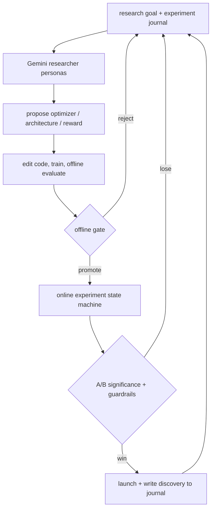
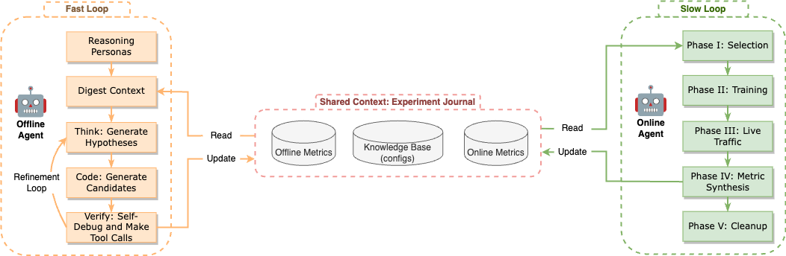

<!-- source-sha256: 34a4cf09ed06281af60e3c1a887adfb4ce9e69a3ee7f016d17c8b8b6fa1c8dbd -->

[简体中文](README.md) · English

# Self-Evolving Recommendation System

> **Fidelity: core-mechanism reproduction.** Local `SmolLM2-135M-Instruct` reads the journal, scores executable configurations, proposes untried configurations each round, and receives validation feedback. Google's production A/B infrastructure is not reproduced.

## Paper information

| Field | Details |
| --- | --- |
| Paper | [arXiv 2602.10226](https://arxiv.org/abs/2602.10226) |
| Institution | Google / YouTube |
| First public release | 2026-02-10 (arXiv v1) |
| Author code | No official or author-released code found in the paper (checked 2026-08-09). |
| Local adapter or method key | `self-evolving-rec` |
| Local reproduction code | [`src/auto_research/reproductions/self_evolving_rec/`](https://github.com/daiwk/auto-research/tree/main/src/auto_research/reproductions/self_evolving_rec/) |

## Original paper summary

### Background and main changes

Recommendation research usually depends on people proposing hypotheses, editing code, running offline experiments, and requesting online A/B tests. The resulting knowledge is often scattered. This paper puts Gemini 2.5 in two loops. The inner agent uses researcher personas, an experiment journal, and coding/training tools to explore optimizers, architectures, and rewards. The outer state machine handles safety, resource constraints, and real A/B promotion, writing online findings back to memory for the next search round.

<!-- paper-figure:start -->
### Key figure from the paper

> **Figure 1:** The core architecture, its main modules, and their connections. From the [paper](https://arxiv.org/abs/2602.10226); copyright belongs to the authors. Click for the source.
<!-- paper-figure:end -->

### Core equations

The workflow can be abstracted as constrained bilevel optimization:

$$
\theta^*(\Phi)=\arg\min_\theta\mathcal L_{proxy}(D;\theta,\Phi),
$$

$$
\Phi^*=\arg\max_\Phi\mathbb E[M_{online}(\theta^*(\Phi))]\quad
\text{s.t. }G(\Phi)\le C,
$$

where $\Phi$ is the agent's optimizer, architecture, or reward proposal, and $G$ represents training, serving, and safety constraints. The contribution is a loop linking offline proxies, online feedback, and long-term memory, not one new network.

### Offline and online results

The LLM ablation runs 6 independent runs per configuration and explores about 70 ideas. Stronger models, persona specialization, and complete context produce more viable proposals. Production discoveries have the following online results (`*` denotes 95% significance):

| Discovery | YouTube metric | Other surface metric |
|---|---:|---:|
| RMSProp | +0.06%* | +0.12%* |
| 4× training efficiency | -0.01% | +0.06% |
| 2× training efficiency | +0.01% | +0.09%* |
| GLU | +0.06%* | +0.14%* |
| Activation change | -0.02% | +0.12%* |
| Multi-objective reward | +0.03%* | +0.13%* |

The offline funnel uses internal Google data; no downloadable dataset from the same source is public.

## Local reproduction

> **Local comparison:** Human/Adagrad is the baseline. The experimental configuration is promoted by a local LLM agent after four generations of journal → proposal → training → validation feedback, with NDCG@10 **+2.57%**. Test runs only after promotion; this is not one model versus DIN.

The implementation runs an experiment journal, a constrained executable search space, validation promotion, and isolated test. Each generation uses the local instruction LLM and prior metrics to score untried configurations by conditional log-loss and propose them. The search covers Adagrad/RMSProp, a GLU gate, multi-objective reward, and learning rate. Three seeds are run without closed Gemini calls.

| Workflow | Hit@10 | NDCG@10 |
|---|---:|---:|
| Human baseline | 0.0833 ± 0.0043 | 0.0399 ± 0.0018 |
| LLM-agent promoted | **0.0844 ± 0.0054** | **0.0409 ± 0.0028** |

Mean NDCG@10 improves **+2.57%**. Seed 42 promotes a multi-objective reward; seeds 43/44 keep the human baseline, showing that the loop can reject validation regressions. The gain is smaller than seed variation and is not evidence of stable improvement. The MovieLens test holdout is not an online A/B, and constrained search is not Google's production code-editing environment. See [`metrics/movielens-100k-seeds42-44.json`](metrics/movielens-100k-seeds42-44.json).
