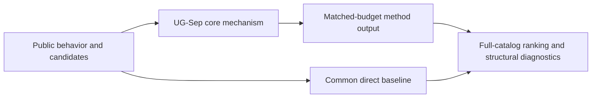
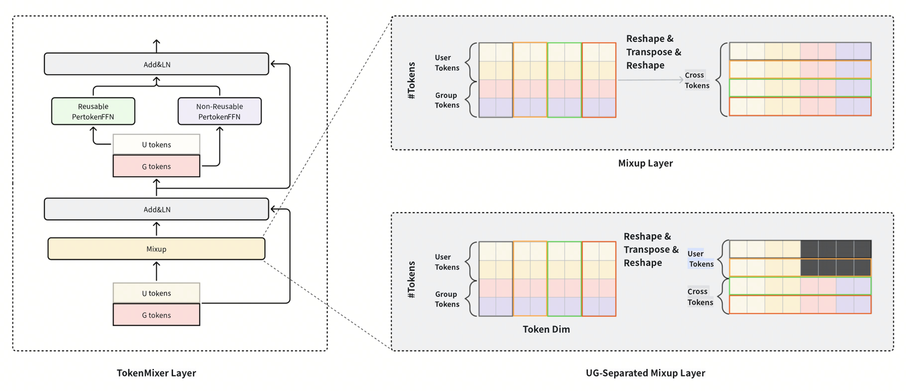

# UG-Sep: compute user representations once

<!-- source-sha256: 881e103296aaaab594e01b83a8079093fbb08244d2834742b307574c3943042e -->

[简体中文](README.md)

> **Fidelity: core mechanism.** Runs the defining mechanism verifiable on public data. Private data, production models, and serving remain outside scope.

## Paper information

| Field | Details |
|---|---|
| Paper | [arXiv 2602.10455](https://arxiv.org/abs/2602.10455) |
| Organization | ByteDance AML |
| First public release | 2026-02-11 (arXiv v1) |
| Authors' code | No public author code was found on 2026-09-05. |
| Adapter / method | `ug-sep` |
| Local reproduction code | [`src/auto_research/reproductions/ug_sep/`](https://github.com/daiwk/auto-research/tree/main/src/auto_research/reproductions/ug_sep/) |

## Original paper

### Motivation and method

An attention/TokenMixer mask blocks backward information flow from candidates to user tokens, allowing the user representation to be reused across candidates in one request. Information Compensation restores user–candidate interactions suppressed by masking.



<!-- paper-figure:start -->
### Key figure from the paper

[](https://arxiv.org/html/2602.10455v2/tokenmixer-0520.png)

> **Figure 1:** Overview of the paper's method and key components. From the [original paper](https://arxiv.org/abs/2602.10455); copyright remains with the authors.
<!-- paper-figure:end -->

### Core equations

$$
H_u'=\mathrm{Mixer}(H_u;M_{UG}),\qquad s(u,i)=f(H_u',e_i)+g(H_u',e_i).
$$

### Paper results

Industrial inference latency falls by up to 20%; W8A16 mitigates the remaining memory bottleneck after reuse. This is paper evidence, not a local public-data outcome.

## Local reproduction

> **Local comparison:** Under the same full-catalog protocol, baseline NDCG@10 is 0.05401 and UG-Sep NDCG@10 is 0.04934, **-8.65%** relative. The local proxy does not extrapolate to online lift.

See the [three-seed artifact](metrics/public-seeds42-44.json) for complete results, means, standard deviations, and 95% confidence intervals.

```bash
auto-research reproduce --paper ug-sep --dataset-dir data --seeds 42,43,44
```

## Reproduction boundaries

The local run uses a fixed public MovieLens 100K subset and auditable proxies to validate the core computation. It does not reproduce private logs, production models, online traffic assignment, or serving. No claim is made to reproduce absolute paper metrics or online gains.
