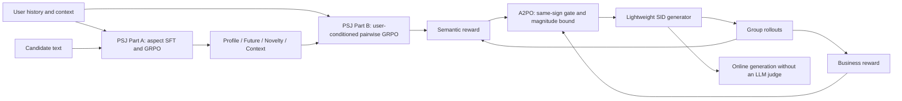
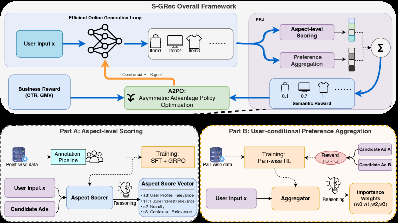

# S-GRec: Personalized Semantic-Aware Generative Recommendation with Asymmetric Advantage

<!-- source-sha256: 386d315588fa4ccc96a2c89e0ece244af44197393b4fc3b9fb8a3a31bb029391 -->

[简体中文](README.md)

> **Fidelity: full core pipeline.** The local run executes causal-LLM LoRA judging, aspect-scoring SFT+GRPO, user-conditioned pairwise GRPO for aspect weights, autoregressive SID generation, 5% sparse semantic sampling, and Reward-Sum, Adv-Sum, and A2PO from the same SFT checkpoint. Model and data scale are reduced; labels built from public Office interactions and Qwen embeddings replace private human ads annotations and the eCPM model.

## Paper information

| Field | Details |
|---|---|
| Paper | [arXiv 2602.10606](https://arxiv.org/abs/2602.10606) |
| Organization | Tencent / WeChat Channels |
| First public release | 2026-02-11 (arXiv v1) |
| Authors' code | No official or author implementation is linked in the paper (checked 2026-08-09). |
| Adapter / method | `s-grec` |
| Local reproduction code | [`src/auto_research/reproductions/s_grec/`](https://github.com/daiwk/auto-research/tree/main/src/auto_research/reproductions/s_grec/) |

## Original paper

### Motivation and method

Generative recommenders trained with next-item likelihood alone cannot readily explain which content attributes account for a user's preference. Putting an LLM in the live request path fails to meet industrial latency constraints. S-GRec uses an LLM only as an offline judge: the two-stage Personalized Semantic Judge (PSJ) first produces interpretable evidence by aspect, then learns per-user aspect weights. The lightweight online generator emits only Semantic IDs and needs no LLM judge.

Semantic and revenue objectives may conflict. Instead of adding raw rewards at incompatible scales, A2PO standardizes business and semantic advantages separately inside each rollout group and anchors the update to business advantage. It adds semantic advantage only if the signs agree and caps its effective magnitude by that of the business advantage. PSJ is queried for only 5% of samples.



<!-- paper-figure:start -->
### Key figure from the paper

[](https://ar5iv.labs.arxiv.org/html/2602.10606/assets/x4.png)

> **Figure 2:** Training flow and key optimization stages. From the [original paper](https://arxiv.org/abs/2602.10606); copyright remains with the authors.
<!-- paper-figure:end -->

### Core equations

PSJ outputs aspect vector $\mathbf{s}(x,a)$; the user-conditioned aggregator provides nonnegative, normalized weights $\mathbf{w}(x)$:

$$
s_{\mathrm{hol}}(x,a)=\mathbf{w}(x)^\top\mathbf{s}(x,a).
$$

For preferred pair $a_i\succ a_j$, sample a group of discrete weight vectors and reward agreement with the pairwise ranking:

$$
r_{\mathrm{pw}}^{(g)}=\mathbb{I}\left[s_{\mathrm{hol}}^{(g)}(x,a_i)>s_{\mathrm{hol}}^{(g)}(x,a_j)\right].
$$

A2PO combines advantages with an adaptive coefficient:

$$
A^{(i)}=A_{\mathrm{biz}}^{(i)}+\lambda^{(i)}A_{\mathrm{sem}}^{(i)},
$$

$$
\lambda^{(i)}=\mathbb{I}[\operatorname{sign}(A_{\mathrm{biz}}^{(i)})=\operatorname{sign}(A_{\mathrm{sem}}^{(i)})]
\frac{\min(|A_{\mathrm{biz}}^{(i)}|,|A_{\mathrm{sem}}^{(i)}|)}
{\max(|A_{\mathrm{biz}}^{(i)}|,|A_{\mathrm{sem}}^{(i)}|)+\epsilon}.
$$

Thus $|\lambda A_{\mathrm{sem}}|\le |A_{\mathrm{biz}}|$. The combined $A$ enters the clipped group policy objective.

### Paper results

- Office: MiniOneRec HR@10 0.1634 and NDCG@10 0.1242; S-GRec 0.1689 and 0.1308, relative gains of about +3.4% and +5.3%.
- Industrial: MiniOneRec HR@10 0.1586 and NDCG@10 0.1167; S-GRec 0.1632 and 0.1202, about +2.9% and +3.0%.
- PSJ Part A: Qwen3-4B SFT+GRPO PairAUC 0.8116 and PointAcc 0.8687.
- Reward-Sum Office HR@10 falls to 0.0904, illustrating instability when adding raw rewards.
- 5% semantic sampling retains 99.1% of the full-query Office result at approximately 20-fold lower inference cost.
- On 20% of WeChat Channels ads traffic: GMV +1.19%, GMV-Normal +1.55%, CTR +1.16%, dislike −2.02%.

## Local reproduction

> **Local comparison.** The MiniOneRec-style `business` SFT checkpoint uses the same public Office data, SID Transformer, and 600-step budget. `a2po` starts from that exact checkpoint and runs 240 policy updates. Relative test HR@10 is **0.00%** and NDCG@10 **-4.53%**. A2PO is selected by the prespecified validation HR@10-first rule. This is not a comparison against DIN or the online A/B test.

The evaluation ranks all 3,459 catalog items after masking user history, not sampled candidates. Training uses 12,000 Office sequences, with fixed samples of 96 users each for validation and test. Public data has no timestamp and location context for the judge, so the local run follows the paper's Amazon setting, drops Context, and trains the discrete Profile, Future, and Novelty aspects.

| Variant | Validation HR@10 | Validation NDCG@10 | Test HR@10 | Test NDCG@10 |
|---|---:|---:|---:|---:|
| MiniOneRec-style SFT | 0.09375 | 0.07949 | 0.04167 | 0.03013 |
| Reward-Sum | 0.10417 | 0.07450 | 0.04167 | 0.02877 |
| Adv-Sum | 0.10417 | 0.07450 | 0.04167 | 0.02877 |
| A2PO | 0.10417 | 0.07450 | 0.04167 | 0.02877 |

PSJ SFT loss falls from 1.3690 to 1.1725. Point accuracy improves from 0.3490 to 0.3802 after GRPO; pairwise accuracy is 0.5938. A2PO invokes PSJ 9 times across 240 updates (a realized Bernoulli sample at 5%). Business and semantic advantage signs agree 42.36% of the time; the average effective coefficient is 0.1426, and the magnitude cap is never violated. The three ablations use identical rollouts, negatives, and semantic-query masks.

Successive refinements fixed collapsed embedding labels, pinned the MiniOneRec baseline to the SFT checkpoint, disabled generator dropout, and aligned rollout seeds across ablations. Final clipping fraction is 0. A2PO wins validation HR@10 without improving held-out scores; no effect reproduction is claimed.

```bash
auto-research reproduce --paper s-grec --seed 42
```

See [stable metrics](metrics/office-seed42.json). Models, checkpoints, public data, and raw `runs/` outputs are not committed.

## Reproduction limits

- Qwen3-4B PSJ is scaled down to SmolLM2-135M; the Qwen2.5-1.5B MiniOneRec becomes a 0.41M-parameter SID Transformer. The judge, two-stage training, generation, and policy paths all execute.
- DeepSeek-R1 initial labels, 20k human pointwise annotations, and 40k pairwise annotations on private ads are unavailable. Real next-item comparisons and Qwen item embeddings supply three discrete labels. This is the largest data-fidelity gap.
- Public data has no monetary signal. The business reward is the ground-truth next-item ranking proxy explicitly allowed by the paper, not eCPM.
- The GRPO Sample Server, periodic release process, and WeChat ads inventory are not reproduced. The serving model itself does not call PSJ, preserving the boundary between offline judging and online generation.
