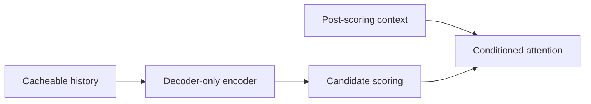
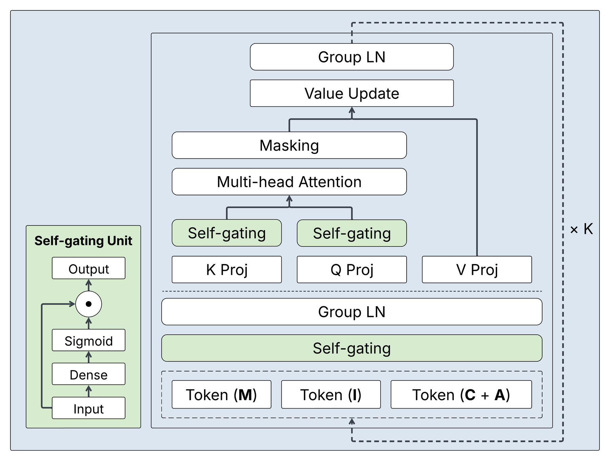

# CADET: Context-Conditioned Ads CTR Prediction With a Decoder-Only Transformer

<!-- source-sha256: 42158ee7687fe60a2cd795f77cafa62434f10d1f4d32bbad56635fbddd41b1fb -->

[简体中文](README.md)

> Core public-data mechanism, not the production A/B.

## Paper information

| Field | Details |
|---|---|
| Paper | [arXiv 2602.11410](https://arxiv.org/abs/2602.11410) |
| Institution | LinkedIn. |
| First public release | 2026-02-11 (arXiv v1) |
| Author code | No official author code linked by the paper as checked on 2026-08-24. |
| Local adapter or method key | `cadet` |
| Local reproduction code | [`src/auto_research/reproductions/cadet/`](https://github.com/daiwk/auto-research/tree/main/src/auto_research/reproductions/cadet/) |

## Paper method and evidence

A decoder-only Transformer encodes cacheable histories, then injects post-scoring context after candidate scoring to align training with serving and unify ad CTR prediction.



<!-- paper-figure:start -->
### Original paper figure

[](https://arxiv.org/html/2602.11410v2/figures/paper_self_gating.png)

The original figure shows cacheable history and post-scoring context. From the [original paper](https://arxiv.org/abs/2602.11410); copyright remains with the authors.
<!-- paper-figure:end -->

### Core equation

$$
h_i'=h_i+\operatorname{Attn}(q(c),K(h_{\le i}),V(h_{\le i}))
$$

### Reported results

Section 5.3/Table 3 reports **CTR +11.04%** in large-scale online A/B.

## Local reproduction

NDCG@10 **0.0540→0.0507 (-6.20%)**, Hit@10 **0.1091→0.1000**. Same MovieLens-100K 220 users/360 items, full catalog, split and seed 42, using a shared transition + content baseline. Validation selects only blend weight; test does not tune. The local model has independent state and scoring. No private features, production checkpoint or online serving; retain negative results.

```bash
auto-research reproduce --paper cadet --dataset-dir data --seed 42
```

[Fixed metrics](metrics/public-seed42.json).
