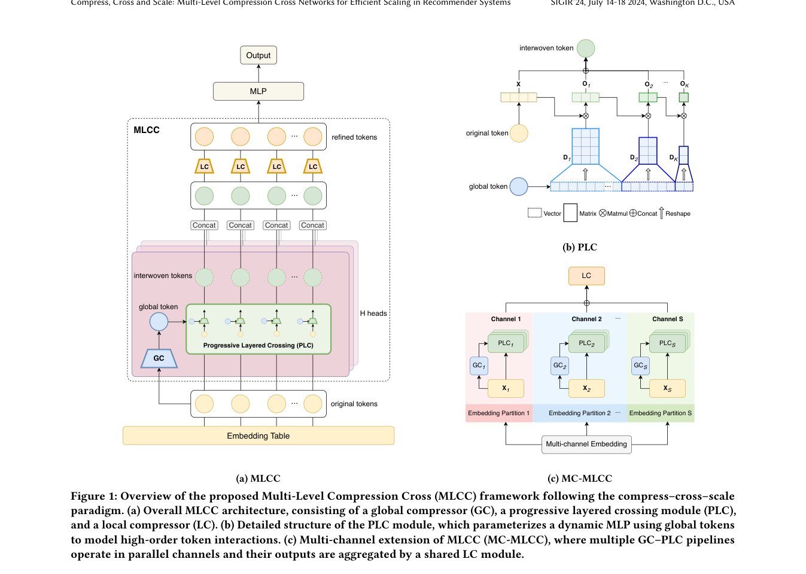

# MLCC: multilayer compressed cross networks

<!-- source-sha256: 90299550cb4cd62d637e3f2a089e1dd29d3273a1eb577720f68a0b1b4640fcf0 -->

[简体中文](README.md)

> **Fidelity: core mechanism.** Runs the defining mechanism verifiable on public data. Private data, production models, and serving remain outside scope.

## Paper information

| Field | Details |
|---|---|
| Paper | [arXiv 2602.12041](https://arxiv.org/abs/2602.12041) |
| Organization | Bilibili |
| First public release | 2026-02-12 (arXiv v1) |
| Authors' code | [https://github.com/shishishu/MLCC](https://github.com/shishishu/MLCC) |
| Adapter / method | `mlcc` |
| Local reproduction code | [`src/auto_research/reproductions/mlcc/`](https://github.com/daiwk/auto-research/tree/main/src/auto_research/reproductions/mlcc/) |

## Original paper

### Motivation and method

Each layer compresses high-dimensional features, applies dynamic explicit feature crosses in the compact space, and projects them back into the backbone. MC-MLCC uses parallel subspaces to increase expressivity while controlling parameter and FLOP growth.


<!-- paper-figure:start -->
### Key figure from the paper

[](https://arxiv.org/pdf/2602.12041#page=5)

> **Figure 1:** Overall workflow, stages, and data flow. From the [original paper](https://arxiv.org/abs/2602.12041); copyright remains with the authors.
<!-- paper-figure:end -->

### Core equations

$$
z_l=C_l(x_l),\qquad x_{l+1}=x_l+P_l\bigl(z_l\odot g_l(z_l)\bigr).
$$

### Paper results

The paper reports up to +0.52% AUC, over 26× lower FLOPs, and a 32% increase in Advertiser Value in production experiments. This is paper evidence, not a local public-data outcome.

## Local reproduction

> **Local comparison:** Under the same full-catalog MovieLens protocol, baseline NDCG@10 is 0.05401 and treatment NDCG@10 is 0.05530, **+2.40%** relative. The local proxy and production task differ, so there is no extrapolation to online lift.

See the [three-seed artifact](metrics/public-seeds42-44.json) for complete results, means, standard deviations, and 95% confidence intervals.

```bash
auto-research reproduce --paper mlcc --dataset-dir data --seeds 42,43,44
```

## Reproduction boundaries

The local run uses a fixed public MovieLens 100K subset and auditable proxies to check the core computation only. It does not reproduce private logs, the production foundation model, online traffic assignment, or serving. There is no claim to reproduce absolute paper metrics or online gains.
