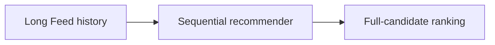
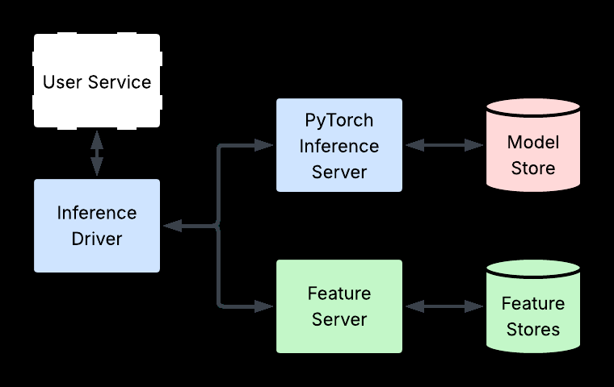

# An Industrial-Scale Sequential Recommender for LinkedIn Feed Ranking

<!-- source-sha256: baddef533e464c40809c722c7ca414b00cd8d45780bdd109fa0a58a9e9b06ba1 -->

[简体中文](README.md)

> **Fidelity: core mechanism.** Paper online outcomes, local public-data results, and omissions are reported separately.

## Paper information

| Field | Details |
|---|---|
| Paper | [arXiv 2602.12354](https://arxiv.org/abs/2602.12354) |
| Organization | LinkedIn |
| First public release | 2026-02-12 (arXiv v1) |
| Authors' code | The paper did not provide official or author code when checked on 2026-08-24. |
| Adapter / method | `linkedin-feed-sr` |
| Local reproduction code | [`src/auto_research/reproductions/linkedin_feed_sr/`](https://github.com/daiwk/auto-research/tree/main/src/auto_research/reproductions/linkedin_feed_sr/) |

## Original paper

### Motivation and method

Unify Feed candidates, interaction history, and context into a very long sequence, with HSTU-style target attention, evaluation without sampled negatives, and incremental serving optimizations.



<!-- paper-figure:start -->
### Key figure from the paper

[](https://arxiv.org/html/2602.12354v2/pics/system_diagram.png)

> **Figure 3:** Overall workflow, key stages, and data flow. From the [original paper](https://arxiv.org/abs/2602.12354); copyright remains with the authors.
<!-- paper-figure:end -->

### Core equations

$$
h_t=\operatorname{HSTU}(e_{1:t}),\quad s_i=\langle h_t,e_i\rangle
$$

### Paper results

Production A/B reports **time spent +2.10%** (Section 7, Table 5). The private paper protocol is not directly comparable with local MovieLens measurements.

## Local reproduction

> **Local comparison:** The baseline is the shared transition + content scorer. The treatment adds only linkedin-feed-sr on the same users, items, full-catalog candidates, and seed.

MovieLens-100K, 220 users and 360 items, seed 42: NDCG@10 0.0540 → **0.0539 (-0.12%)**; Hit@10 0.1091 → 0.1091. Validation selects mixture weights only; the test set is not used for tuning.

```bash
auto-research reproduce --paper linkedin-feed-sr --dataset-dir data --seed 42
```

See the [fixed metrics](metrics/public-seed42.json).

## Reproduction boundaries

The core mechanism runs on MovieLens-100K with the same split, fixed full-catalog candidates, and seed. Private features, the production foundation model, and online traffic are unavailable. The implementation has independent model state and scoring and retains negative results. Local changes and paper A/B gains are reported separately.
