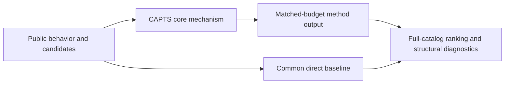
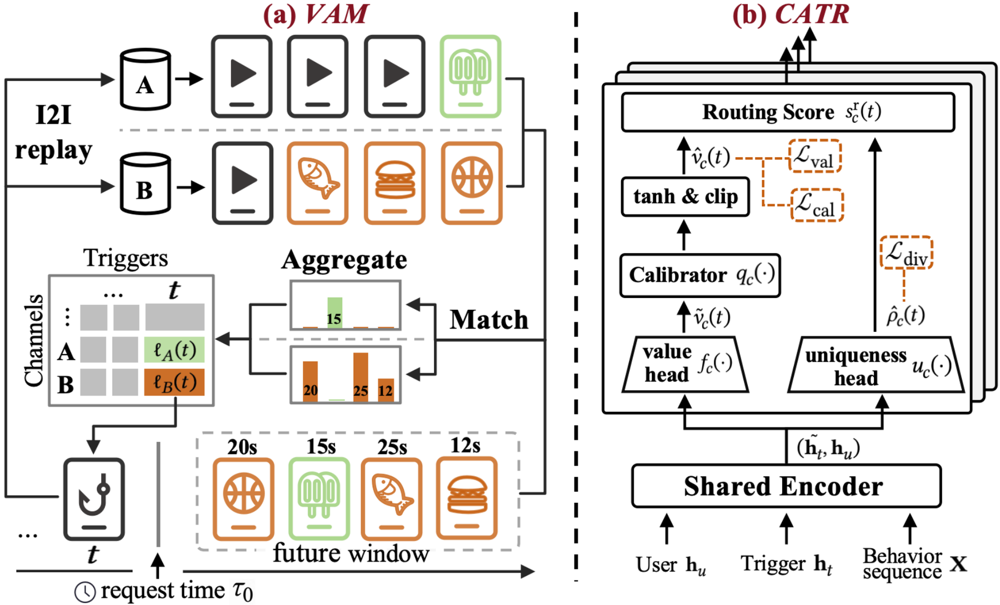

# CAPTS: preference-aligned multichannel trigger selection

<!-- source-sha256: 78d2c171e4effebdcec93bfda1b1bf29424b64de27484bb9dccb2c33ad85b9ac -->

[简体中文](README.md)

> **Fidelity: core mechanism.** Runs the defining mechanism verifiable on public data. Private data, production models, and serving remain outside scope.

## Paper information

| Field | Details |
|---|---|
| Paper | [arXiv 2602.12564](https://arxiv.org/abs/2602.12564) |
| Organization | Kuaishou Technology |
| First public release | 2026-02-13 (arXiv v1) |
| Authors' code | No public author code was found on 2026-09-05. |
| Adapter / method | `capts` |
| Local reproduction code | [`src/auto_research/reproductions/capts/`](https://github.com/daiwk/auto-research/tree/main/src/auto_research/reproductions/capts/) |

## Original paper

### Motivation and method

VAM attributes downstream consumption from two-hop retrieved items to the trigger rather than using only trigger-item feedback. CATR jointly routes triggers to I2I channels to reduce overlap and improve complementary coverage.



<!-- paper-figure:start -->
### Key figure from the paper

[](https://arxiv.org/html/2602.12564v2/vam-catr.png)

> **Figure 3:** Core architecture, modules, and connections. From the [original paper](https://arxiv.org/abs/2602.12564); copyright remains with the authors.
<!-- paper-figure:end -->

### Core equations

$$
v(h)=\sum_{c\in\mathcal C}\sum_{j\in R_c(h)}w_{c,j}y_j,\qquad \max_\pi\sum_c v(h,c)-\lambda\,\mathrm{Overlap}.
$$

### Paper results

Kwai online experiments report total app time +0.713%, average time per device +0.586%, and daily active devices +0.115%. This is paper evidence, not a local public-data outcome.

## Local reproduction

> **Local comparison:** Under the same full-catalog protocol, baseline NDCG@10 is 0.05401 and CAPTS NDCG@10 is 0.05500, **+1.84%** relative. The local proxy does not extrapolate to online lift.

See the [three-seed artifact](metrics/public-seeds42-44.json) for complete results, means, standard deviations, and 95% confidence intervals.

```bash
auto-research reproduce --paper capts --dataset-dir data --seeds 42,43,44
```

## Reproduction boundaries

The local run uses a fixed public MovieLens 100K subset and auditable proxies to validate the core computation. It does not reproduce private logs, production models, online traffic assignment, or serving. No claim is made to reproduce absolute paper metrics or online gains.
