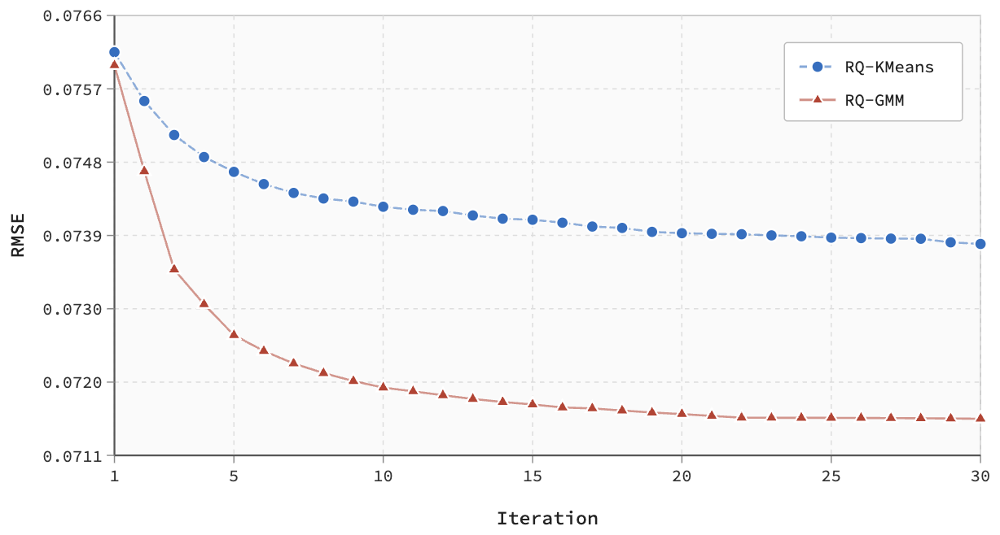

# RQ-GMM: Probabilistic residual quantization for multimodal semantics

<!-- source-sha256: cef5e2dfc02f8ef2aaf275cf459d3a5b3c685c569a82977fd16c24fd5e26ce48 -->

[简体中文](README.md)

> Core public-data mechanism, not the production stack.

## Paper information

| Field | Details |
|---|---|
| Paper | [arXiv 2602.12593](https://arxiv.org/abs/2602.12593) |
| Institution | Tencent. |
| First public release | 2026-02-13 (arXiv v1) |
| Author code | No public author code found as of 2026-09-05. |
| Local adapter or method key | `rq-gmm` |
| Local reproduction code | [`src/auto_research/reproductions/rq_gmm/`](https://github.com/daiwk/auto-research/tree/main/src/auto_research/reproductions/rq_gmm/) |

## Paper method and evidence

Quantize image/text embeddings in residual stages with Gaussian-mixture posterior soft assignments to improve codebook utilization relative to hard clustering. Train semantic discretization separately from CTR preference modeling.


<!-- paper-figure:start -->
### Original paper figure

[](https://arxiv.org/html/2602.12593v1/convergence.png)

The original figure shows residual quantization and preference modeling. From the [original paper](https://arxiv.org/abs/2602.12593); copyright remains with the authors.
<!-- paper-figure:end -->

### Core equation

$$
q^{(l)}=\sum_k p(k\mid r^{(l)})\mu_k^{(l)},\qquad r^{(l+1)}=r^{(l)}-q^{(l)}.
$$

### Reported results

Large online A/B reports Advertiser Value **+1.502%**. This is only author evidence.

## Local reproduction

Same MovieLens-100K full-catalog protocol: NDCG@10 **0.05401→0.04685 (-13.25%)**. The public proxy cannot predict online lift. [Three-seed measurements, mean, SD and 95% CI](metrics/public-seeds42-44.json).

```bash
auto-research reproduce --paper rq-gmm --dataset-dir data --seeds 42,43,44
```

Fixed public subset and auditable proxy, not private logs, production foundation model, traffic splitting or serving.
