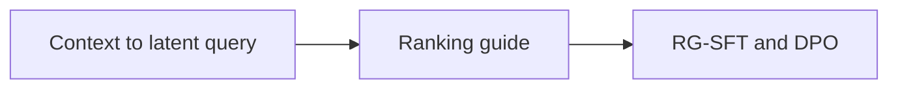
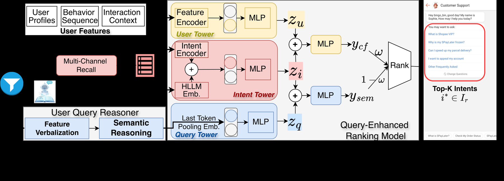

# RGAlign-Rec: Ranking-Guided Alignment for Latent Query Reasoning in Recommendation Systems

<!-- source-sha256: fc47fdacdbbe53f8d9dc3caceb0315fc90b9ef0ef6855075fa11693021bafdc6 -->

[简体中文](README.md)

> **Fidelity: core mechanism.** Paper online outcomes, local public-data results, and omissions are separate.

## Paper information

| Field | Details |
|---|---|
| Paper | [arXiv 2602.12968](https://arxiv.org/abs/2602.12968) |
| Organization | Forth AI / Shopee / Singapore University of Technology and Design |
| First public release | 2026-02-13 (arXiv v1) |
| Authors' code | The paper did not provide official or author code when checked on 2026-08-24. |
| Adapter / method | `rgalign-rec` |
| Local reproduction code | [`src/auto_research/reproductions/rgalign_rec/`](https://github.com/daiwk/auto-research/tree/main/src/auto_research/reproductions/rgalign_rec/) |

## Original paper

### Motivation and method

Generate latent queries from context with an LLM. Use item preferences from a real ranker to build positive and negative queries, then align high-ranked intents through RG-SFT and DPO.



<!-- paper-figure:start -->
### Key figure from the paper

[](https://ar5iv.labs.arxiv.org/html/2602.12968/assets/graph/RGAlign-Rec-Solution.png)

> **Figure 2:** Core architecture, modules, and connections. From the [original paper](https://arxiv.org/abs/2602.12968); copyright remains with the authors.
<!-- paper-figure:end -->

### Core equations

$$
L_{DPO}=-\log\sigma(\beta[\log\pi(q^w)-\log\pi(q^l)])
$$

### Paper results

Large-scale online A/B reports **CTR@3 +0.13% incremental over QE-Rec** (Section 5.4, Table 5). The private paper protocol is not directly comparable with local MovieLens measurements.

## Local reproduction

> **Local comparison:** The baseline is the shared transition + content scorer. The treatment adds only rgalign-rec on the same users, items, full-catalog candidates, and seed.

MovieLens-100K, 220 users and 360 items, seed 42: NDCG@10 0.0540 → **0.0464 (-14.03%)**; Hit@10 0.1091 → 0.0727. Validation selects mixture weights only; the test set is not used for tuning.

```bash
auto-research reproduce --paper rgalign-rec --dataset-dir data --seed 42
```

See the [fixed metrics](metrics/public-seed42.json).

## Reproduction boundaries

The core mechanism runs on MovieLens-100K with the same split, fixed full-catalog candidates, and seed. Private features, the production foundation model, and online traffic are unavailable. The implementation has independent model state and scoring and retains negative results. Local changes and paper A/B gains are reported separately.
