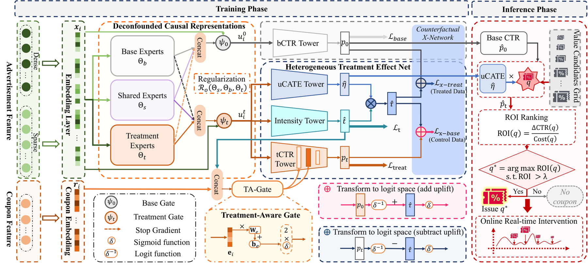

# UniMVT: Joint modeling of debiased CTR and coupon uplift

<!-- source-sha256: 45e4d2384cdce6dad2c542b71abc064929e55e2c36b9e4186698660a5a4ef1ab -->

[简体中文](README.md)

> Core public-data uplift mechanism.

## Paper information

| Field | Details |
|---|---|
| Paper | [Paper or original source](https://arxiv.org/abs/2602.12972) |
| Institution | Kuaishou Technology. |
| First public release | 2026-02-13 (arXiv v1) |
| Author code | No public author code found as of 2026-09-05. |
| Local adapter or method key | `unimvt` |
| Local reproduction code | [`src/auto_research/reproductions/unimvt/`](https://github.com/daiwk/auto-research/tree/main/src/auto_research/reproductions/unimvt/) |

## Paper method and evidence

Separate base click propensity from coupon-intensity sensitivity with deconfounded representations. Dual prediction towers and a counterfactual X-Network constrain factual and counterfactual outcomes. Unit uplift puts coupon tiers on one scale.


<!-- paper-figure:start -->
### Original paper figure

[](https://arxiv.org/html/2602.12972v2/main_0514.png)

Figure shows debiasing and counterfactual uplift. From the [original paper](https://arxiv.org/abs/2602.12972); copyright remains with the authors.
<!-- paper-figure:end -->

### Core equation

$$
\hat\tau(x,t)=\hat p_t(x,t)-\hat p_0(x),\qquad \mathcal L=\mathcal L_{base}+\mathcal L_{treat}+\lambda\mathcal L_{cf}.
$$

### Reported results

Kuaishou on 10% traffic reports coupon revenue +18.14%, ROI +8.80, and coupon PCOC error reduced by 86.51%.

## Local reproduction

MovieLens-100K full catalog: NDCG@10 **0.05401→0.03955 (-26.76%)**. [Three-seed metrics, mean, SD, and 95% CI](metrics/public-seeds42-44.json). No private logs, production models, bucketing or serving. Public proxies cannot establish online lift.

```bash
auto-research reproduce --paper unimvt --dataset-dir data --seeds 42,43,44
```
