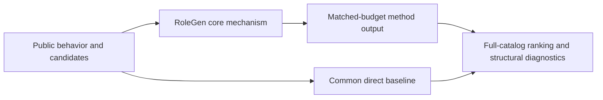
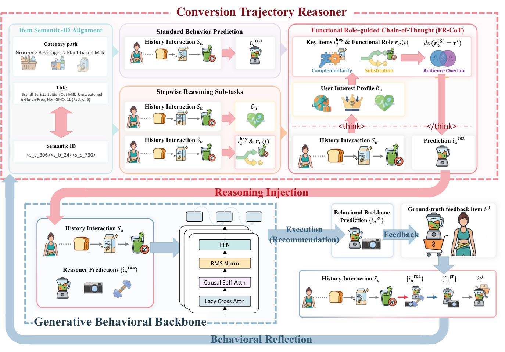

# RoleGen: counterfactual item-role reasoning for dormant users

<!-- source-sha256: 6934d9efbc6b35f01dd885344e1ceb18d8cc302016c25878385b512e5555b4cf -->

[简体中文](README.md)

> **Fidelity: core mechanism.** Runs the defining mechanism verifiable on public data. Private data, production models, and serving remain outside scope.

## Paper information

| Field | Details |
|---|---|
| Paper | [arXiv 2602.13134](https://arxiv.org/abs/2602.13134) |
| Organization | Beihang University |
| First public release | 2026-02-13 (arXiv v1) |
| Authors' code | No public author code was found on 2026-09-05. |
| Adapter / method | `rolegen` |
| Local reproduction code | [`src/auto_research/reproductions/rolegen/`](https://github.com/daiwk/auto-research/tree/main/src/auto_research/reproductions/rolegen/) |

## Original paper

### Motivation and method

An LLM reasoner identifies each item's functional role in a conversion trajectory and estimates its instrumental effect via counterfactual paths. Candidates enter an SID-generation backbone and iterate through reasoning, execution, feedback, and reflection to reduce interest collapse for dormant users.



<!-- paper-figure:start -->
### Key figure from the paper

[](https://arxiv.org/html/2602.13134v1/model.png)

> **Figure 2:** Core architecture, modules, and connections. From the [original paper](https://arxiv.org/abs/2602.13134); copyright remains with the authors.
<!-- paper-figure:end -->

### Core equations

$$
\Delta_i=\mathbb E[Y|do(i)]-\mathbb E[Y|do(\neg i)],\qquad s_i=s_{backbone,i}+\lambda\Delta_i.
$$

### Paper results

Kuaishou e-commerce reports offline Recall@1 +6.2% and online orders +7.3%. This is paper evidence, not a local public-data outcome.

## Local reproduction

> **Local comparison:** Under the same full-catalog protocol, baseline NDCG@10 is 0.05401 and RoleGen NDCG@10 is 0.05605, **+3.78%** relative. The local proxy does not extrapolate to online lift.

See the [three-seed artifact](metrics/public-seeds42-44.json) for complete results, means, standard deviations, and 95% confidence intervals.

```bash
auto-research reproduce --paper rolegen --dataset-dir data --seeds 42,43,44
```

## Reproduction boundaries

The local run uses a public MovieLens-1M subset and auditable proxies to validate the core computation. It does not reproduce private logs, production models, online traffic assignment, or serving. No claim is made to reproduce absolute paper metrics or online gains.
