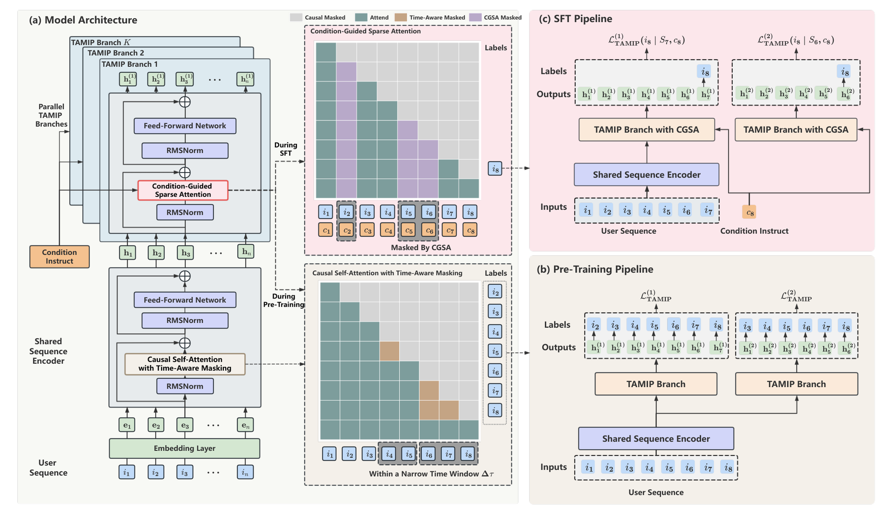

# Climber-Pilot: Non-myopic instruction-following retrieval

<!-- source-sha256: 385455832e32d45c69645e2e33b6c59ee3cdbdb8d25d911ab80416eca7638e55 -->

[简体中文](README.md)

> Core public-data retrieval mechanism.

## Paper information

| Field | Details |
|---|---|
| Paper | [Paper or original source](https://arxiv.org/abs/2602.13581) |
| Institution | NetEase Cloud Music. |
| First public release | 2026-02-14 (arXiv v1) |
| Author code | No public author code found as of 2026-09-05. |
| Local adapter or method key | `climber-pilot` |
| Local reproduction code | [`src/auto_research/reproductions/climber_pilot/`](https://github.com/daiwk/auto-research/tree/main/src/auto_research/reproductions/climber_pilot/) |

## Paper method and evidence

Time-aware multi-item prediction distills long-horizon consumption into a one-step generator. Condition-guided sparse attention injects category and business constraints without separate filtering or multi-step inference.


<!-- paper-figure:start -->
### Original paper figure

[](https://arxiv.org/html/2602.13581v2/Overall_Framework_fix.png)

Figure shows time-aware and condition-guided retrieval. From the [original paper](https://arxiv.org/abs/2602.13581); copyright remains with the authors.
<!-- paper-figure:end -->

### Core equation

$$
\mathcal L_{TAMIP}=-\sum_{k=1}^{K}w_k\log p(i_{t+k}|H_t),\qquad A'=A\odot M_c.
$$

### Reported results

NetEase Cloud Music A/B reports a core business metric **+4.24%**.

## Local reproduction

```bash
auto-research reproduce --paper climber-pilot --dataset-dir data --seeds 42,43,44
```

MovieLens-1M fixed catalog: NDCG@10 **0.05401→0.09251 (+71.29%)**. [Three-seed metrics, mean, SD and 95% CI](metrics/public-seeds42-44.json). No private features, production traffic or serving. These local public-data results do not reproduce online lift.
