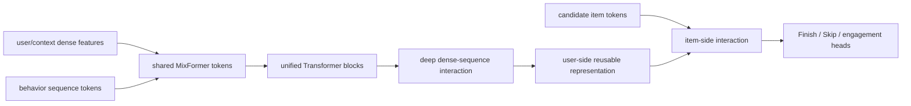
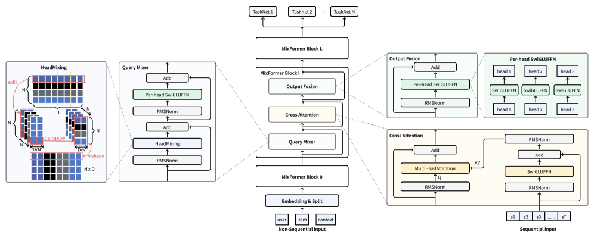

<!-- source-sha256: 625137690726bc6a921de532d6d3827c3de886b968baf493c5038600a8dbd3fd -->

[简体中文](README.md) · English

# MixFormer: Unified dense and sequence scaling

> **Fidelity: full core pipeline.** Trains the stacked baseline and unified MixFormer blocks at matched local budgets. The proposed model puts dense feature-split and behavior tokens in one backbone and reuses user encoding to score all candidates.

## Paper information

| Field | Details |
| --- | --- |
| Paper | [arXiv 2602.14110](https://arxiv.org/abs/2602.14110) |
| Institution | ByteDance / Douyin |
| First public release | 2026-02-15 (arXiv v1) |
| Author code | No official or author-released code found in the paper (checked 2026-08-09). |
| Local adapter or method key | `mixformer` |
| Local reproduction code | [`src/auto_research/reproductions/mixformer/`](https://github.com/daiwk/auto-research/tree/main/src/auto_research/reproductions/mixformer/) |

## Original paper summary

### Background and main changes

Existing recommenders usually separate dense-feature interaction from the behavior-sequence Transformer. Budget is allocated manually between the two, and they interact only at the end. MixFormer embeds nonsequential fields and behavior into one Transformer token space, sharing parameters and enabling high-order interaction at every layer so dense capacity and sequence length scale together. It also decouples user and candidate-item computation to reuse one user representation across candidates in a request.



<!-- paper-figure:start -->
### Key figure from the paper

[](https://arxiv.org/html/2602.14110v2/x1.png)

> **Figure 1:** The core architecture, its main modules, and their connections. From the [paper](https://arxiv.org/abs/2602.14110); copyright belongs to the authors. Click for the source.
<!-- paper-figure:end -->

### Core equations

A unified layer jointly attends over dense tokens $D^l$ and sequence tokens $S^l$:

$$
[D^{l+1};S^{l+1}]=Transformer_l([D^l;S^l]),
$$

whereas the stacked baseline combines separately parameterized $f_D(D)$ and $f_S(S)$ only at the end. User-item decoupling splits

$$
score(u,i)=h([z_u,z_i])
$$

into a reusable $z_u=f_{user}(u,S_u)$ and lightweight item interaction, reducing repeated FLOPs per request.

### Offline and online results

On two weeks of trillion-scale Douyin interactions, MixFormer-medium improves Finish AUC/UAUC by +1.28%/+1.60% and Skip by +1.60%/+2.46% over base. User-item decoupling reduces FLOPs by about 36% at matched quality and accelerates serving by over 30%. All results in the two-week online A/B test are significant:

| App | Active day | Duration | Like | Finish | Comment |
|---|---:|---:|---:|---:|---:|
| Douyin | +0.0415% | +0.2799% | +0.1766% | +0.3897% | +0.7035% |
| Douyin Lite | +0.0252% | +0.4105% | +0.2125% | +0.2924% | +1.9097% |

## Local reproduction

> **Local comparison:** The baseline is parameter-matched Stacked Dense+Sequence, and the experimental arm is Unified MixFormer. NDCG@10 rises from 0.0054 to 0.0063 (**+17.41%**). This ablates stacked versus unified architecture, not a comparison with DIN.

MovieLens-100K genres replace 300+ private dense fields. The stacked baseline uses a separate sequence Transformer and dense MLP, fusing them only at the end. The unified model splits dense columns into 4 feature-head tokens and feeds them with the 32 latest behavior tokens through the same 2-layer Transformer. The arms have 223,424 and 216,576 parameters respectively, avoiding an advantage from a larger proposed model. The unified model encodes the user once and takes dot products with every candidate item vector.

| Architecture | Hit@10 | NDCG@10 |
|---|---:|---:|
| Stacked dense + sequence | 0.0114 ± 0.0010 | 0.0054 ± 0.0009 |
| Unified MixFormer | **0.0118 ± 0.0030** | **0.0063 ± 0.0017** |

At three seeds and 240 steps per model, relative NDCG@10 improves **17.41%**. Absolute scores are low, and the proposed model has higher variance. This supports a positive direction in the small setting, not stable reproduction of the online lift. The older semantic-gate proxy `+0.53%` has been withdrawn.

See [`metrics/movielens-100k-seed42.json`](metrics/movielens-100k-seed42.json). Full run:

```bash
pip install -e '.[neural-recs]'
auto-research reproduce --paper mixformer --dataset-dir data --seed 42
```

Raw runs stay in Git-ignored `runs/`. Only code, tests, documentation, and sanitized metrics are committed.
