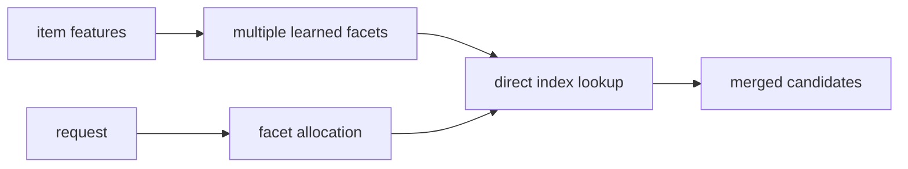
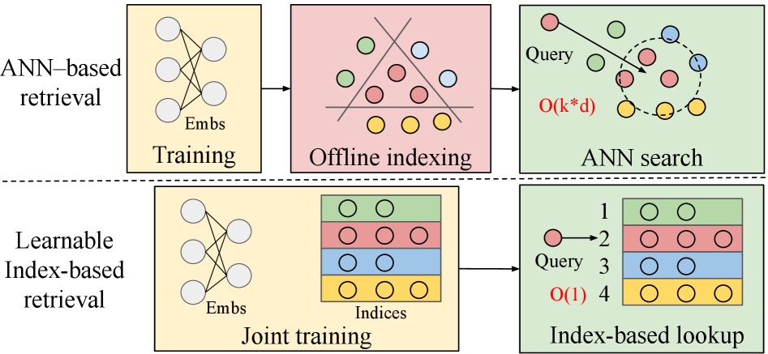

# MFLI: a multifacet learnable index for large-scale recommendation

<!-- source-sha256: 243b6145bef9e2110f3204de4d45d00c9d6b94d1d91f005b406e5b7b05f1f397 -->

[简体中文](README.md)

> **Fidelity: core mechanism.** Learns four facets—genre, two semantic-code levels, and freshness—instead of a single ANN space.

## Paper information

| Field | Details |
|---|---|
| Paper | [arXiv 2602.16124](https://arxiv.org/abs/2602.16124) |
| Organization | Meta |
| First public release | 2026-02-18 (arXiv v1) |
| Authors' code | The paper did not provide official or author code when checked on 2026-08-09. |
| Adapter / method | `mfli` |
| Local reproduction code | [`src/auto_research/reproductions/mfli/`](https://github.com/daiwk/auto-research/tree/main/src/auto_research/reproductions/mfli/) |

## Original paper

### Motivation and method

ANN compresses all retrieval goals into one geometric space. Offline indexing delays fresh content, and online neighbor search becomes more expensive as candidate counts grow. MFLI learns the index jointly as model parameters, uses facets for semantics, popularity, and freshness, and allocates retrieval budgets per facet at request time.



<!-- paper-figure:start -->
### Key figure from the paper

[](https://arxiv.org/html/2602.16124v1#S1.F1)

> **Figure 1:** Compares the conventional three-stage ANN pipeline with jointly learning the index. From the [original paper](https://arxiv.org/abs/2602.16124); copyright remains with the authors.
<!-- paper-figure:end -->

### Core equations

For facet $m$ and code $c_m(i)$, the request dynamically allocates $a_m(q)$:

$$
s(q,i)=\sum_m a_m(q)\,P_m\!\left(c_m(i)\mid c_m(q)\right),\quad a(q)=\operatorname{softmax}(g(q)).
$$

### Paper results

- Seven-day A/B: low-VV content impressions `+279%`, mid-VV `+54%`, and head content `-2%`.
- Ultra-fresh `+221%`, same-day `+10%`, explicit interactions `+0.08%`, diversity `+0.30%`, and QPS `+60%`.

## Local reproduction

> **Local comparison:** Against a same-split single-space ANN proxy, four-facet MFLI gives NDCG@10 `-10.01%`.

Hit@10 is unchanged, NDCG@10 falls `-10.01%`, and head share rises `+9.94%`. Facet allocation on small public data does not reproduce the paper's move away from head content. This result is retained.

See the [metrics](metrics/movielens-100k-seed42.json).

```bash
auto-research reproduce --paper mfli --dataset-dir data --seed 42
```

## Reproduction boundaries

Full-catalog scoring provides a fair experiment, not a test of Meta's billion-scale real-time index, GPU QPS, or private freshness labels.
