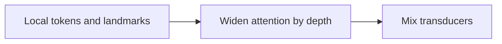
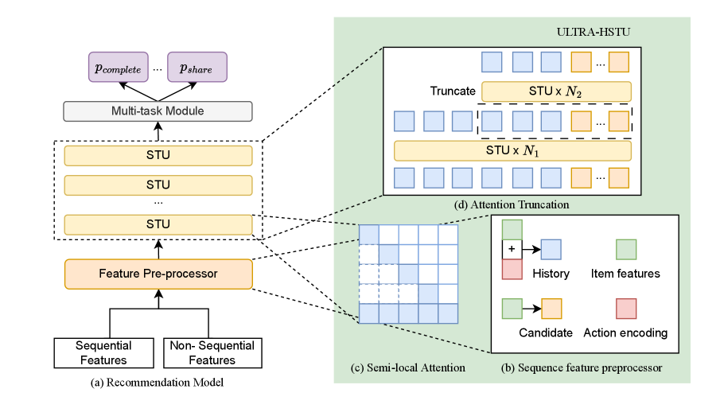

# ULTRA-HSTU: Bend the scaling curve for large recommenders

<!-- source-sha256: 74eae9c53bde49ade63703ddc5cf09719f07a5736fdb792ac225a78c4ea9dd7c -->

[简体中文](README.md)

> Core semi-local attention, LBSL and mixture of transducers.

## Paper information

| Field | Details |
|---|---|
| Paper | [Paper or original source](https://arxiv.org/abs/2602.16986) |
| Institution | Meta. |
| First public release | 2026-02-19 (arXiv v1) |
| Author code | No official author code linked by the paper as checked on 2026-08-09. |
| Local adapter or method key | `ultra-hstu` |
| Local reproduction code | [`src/auto_research/reproductions/ultra_hstu/`](https://github.com/daiwk/auto-research/tree/main/src/auto_research/reproductions/ultra_hstu/) |

## Paper method and evidence

At 16k behaviors and greater depth, HSTU attention and memory bottleneck scaling. Use local tokens and sparse landmarks, widen windows by layer with LBSL, and combine a mixture of transducers with attention truncation, mixed precision and dynamic topology.



<!-- paper-figure:start -->
### Original paper figure

[](https://arxiv.org/html/2602.16986v2)

Figure shows the scalable HSTU architecture. From the [original paper](https://arxiv.org/abs/2602.16986); copyright remains with the authors.
<!-- paper-figure:end -->

### Core equation

$$
\mathcal N_l(t)=\{t-w,\ldots,t\}\cup\mathcal B_l,\qquad w_l=w_0(l+1),
$$

$$
h_{l+1}=h_l+\sum_e \operatorname{softmax}(r(h_l))_eT_e(\operatorname{Attn}_{\mathcal N_l}(h_l)).
$$

Each layer attends only to its local window and block landmarks; LBSL widens the window with depth.

### Reported results

Multiple 30-day A/B tests and full rollout to billions of daily users report consumption +4.11%, engagement +2% to +8%, topline +0.05%/+0.01%, training scaling efficiency 5× and inference 21×.

## Local reproduction

Short-history transition/content control versus six layers, 8-token local windows and wider summaries: Hit@10 **+8.33%**, NDCG@10 **-0.95%**, fresh Hit@10 **+50%**, head share **-13.38%**. [Seed-42 metrics](metrics/movielens-100k-seed42.json). 48 events proxy 16k; no 18-layer production model, dynamic topology, FP8 kernel or private logs. No stable quality claim.

```bash
auto-research reproduce --paper ultra-hstu --dataset-dir data --seed 42
```
