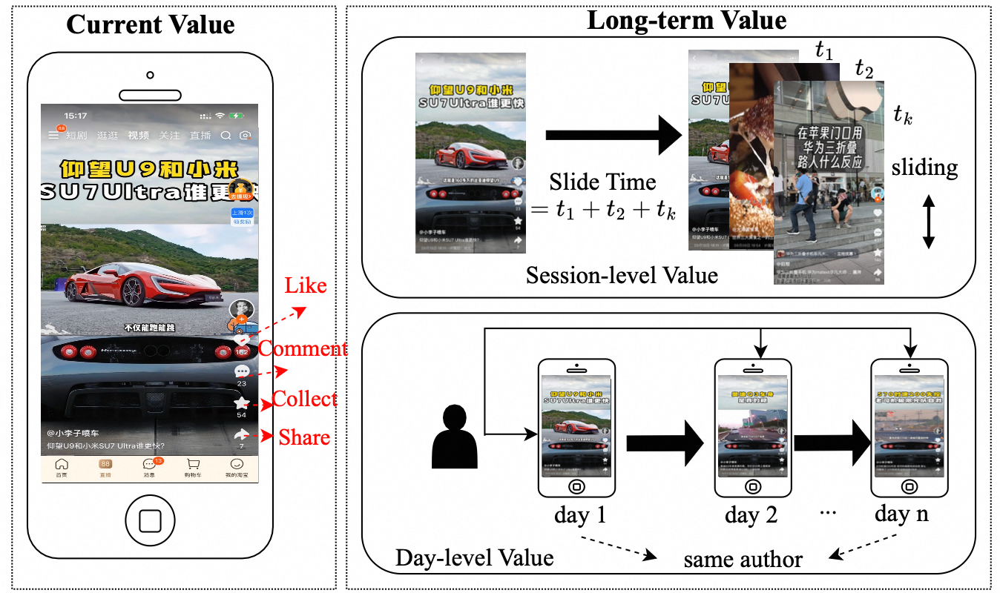

# A Long-term Value Prediction Framework In Video Ranking

<!-- source-sha256: d229a8cf428bdcae6a19e602659e23f43088aca7fa7eb7930196ac737e152779 -->

[简体中文](README.md)

> **Fidelity: core mechanism.** Paper online outcomes, local public-data results, and omissions are reported separately.

## Paper information

| Field | Details |
|---|---|
| Paper | [arXiv 2602.17058](https://arxiv.org/abs/2602.17058) |
| Organization | Alibaba Group / Tsinghua University |
| First public release | 2026-02-19 (arXiv v1) |
| Authors' code | The paper did not provide official or author code when checked on 2026-08-24. |
| Adapter / method | `ltv-video-ranking` |
| Local reproduction code | [`src/auto_research/reproductions/ltv_video_ranking/`](https://github.com/daiwk/auto-research/tree/main/src/auto_research/reproductions/ltv_video_ranking/) |

## Original paper

### Motivation and method

PDQ removes position bias. An attribution module allocates long-term value within a session; creator-period tasks add cross-day value from high-quality creators.


<!-- paper-figure:start -->
### Key figure from the paper

[](https://arxiv.org/html/2602.17058v1/long_term_value_architecture.png)

> **Figure 1:** Core architecture, modules, and connections. From the [original paper](https://arxiv.org/abs/2602.17058); copyright remains with the authors.
<!-- paper-figure:end -->

### Core equations

$$
q_i=F_{Y|pos}^{-1}(F_{Y|pos_i}(y_i)),\quad s=\sum_k w_k v_k
$$

### Paper results

A multi-day production A/B test reports **VV +2.49%** (Section 5.3, Table 6). The private paper protocol is not directly comparable with local MovieLens measurements.

## Local reproduction

> **Local comparison:** The baseline is the shared transition + content scorer. The treatment adds only ltv-video-ranking on the same users, items, full-catalog candidates, and seed.

MovieLens-100K, 220 users and 360 items, seed 42: NDCG@10 0.0540 → **0.0593 (+9.73%)**; Hit@10 0.1091 → 0.1091. Validation selects mixture weights only; the test set is not used for tuning.

```bash
auto-research reproduce --paper ltv-video-ranking --dataset-dir data --seed 42
```

See the [fixed metrics](metrics/public-seed42.json).

## Reproduction boundaries

The core mechanism runs on MovieLens-100K with the same split, fixed full-catalog candidates, and seed. Private features, the production foundation model, and online traffic are unavailable. The implementation has independent model state and scoring and retains negative results. Local changes and paper A/B gains are reported separately.
