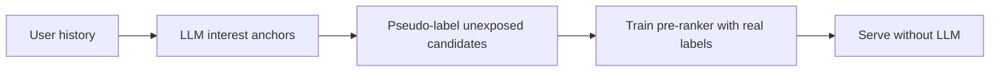
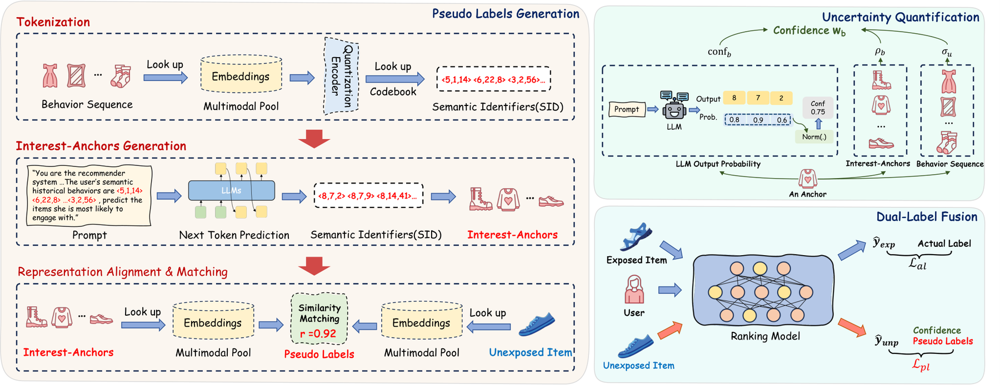

# Generative Pseudo-Labeling for Pre-Ranking with LLMs

<!-- source-sha256: f08d297f47fb7caa922336e618d26e4857a911b75977752f86c33744f994479f -->

[简体中文](README.md)

> Public-data core mechanism, not private production serving.

## Paper information

| Field | Details |
|---|---|
| Paper | [arXiv 2602.20995](https://arxiv.org/abs/2602.20995) |
| Institution | Alibaba Group / Renmin University. |
| First public release | 2026-02-24 (arXiv v1) |
| Author code | No official author code linked by the paper as checked on 2026-08-24. |
| Local adapter or method key | `gpl-prerank` |
| Local reproduction code | [`src/auto_research/reproductions/gpl_prerank/`](https://github.com/daiwk/auto-research/tree/main/src/auto_research/reproductions/gpl_prerank/) |

## Paper method and evidence

An LLM derives interest anchors from user behavior and labels unexposed retrieval candidates. The pre-ranker learns from real and pseudo-supervision without calling the LLM online.



<!-- paper-figure:start -->
### Original paper figure

[](https://arxiv.org/html/2602.20995v2/method.png)

The original figure shows LLM supervision for unexposed candidates. From the [original paper](https://arxiv.org/abs/2602.20995); copyright remains with the authors.
<!-- paper-figure:end -->

### Core equation

$$
L=L_{exposed}+\lambda\sum_{j\in unexposed}CE(\hat y_j^{LLM},p_j)
$$

### Reported results

Section 4.5/Table 4 reports **CTR +3.07%** across two weeks with hundreds of millions of DAU. Not comparable to MovieLens.

## Local reproduction

NDCG@10 **0.0540→0.0609 (+12.84%)**, Hit@10 **0.1091→0.1045**. Same MovieLens-100K 220 users/360 items, full catalog, split and seed 42, using a shared transition + content baseline. Validation selects only blend weight; test does not tune. The local model has independent state and scoring. No private features, production checkpoint or online serving; retain negative results.

```bash
auto-research reproduce --paper gpl-prerank --dataset-dir data --seed 42
```

[Fixed metrics](metrics/public-seed42.json).
