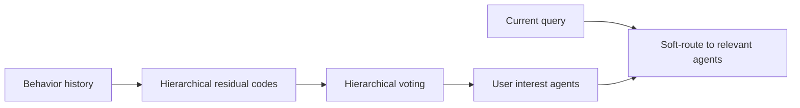
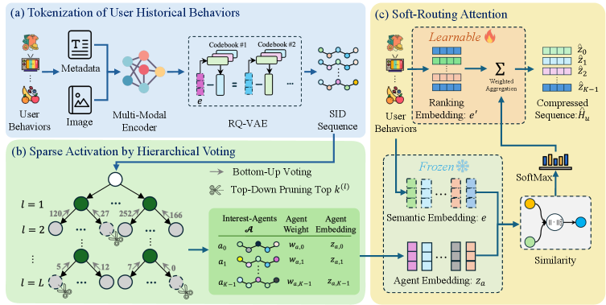

# HiSAC: Compress ultra-long sequences with hierarchical sparse activation

<!-- source-sha256: aaa3ff607d0f0af51516a4e44d8af9d44f9089565dfeb7ad3934bddaf4cb4dbe -->

[简体中文](README.md)

> Core mechanism: residual codes, hierarchical voting, interest agents and soft routing.

## Paper information

| Field | Details |
|---|---|
| Paper | [arXiv 2602.21009](https://arxiv.org/abs/2602.21009) |
| Institution | Alibaba / Taobao. |
| First public release | 2026-02-24 (arXiv v1) |
| Author code | No official author code linked by the paper as checked on 2026-08-09. |
| Local adapter or method key | `hisac` |
| Local reproduction code | [`src/auto_research/reproductions/hisac/`](https://github.com/daiwk/auto-research/tree/main/src/auto_research/reproductions/hisac/) |

## Paper method and evidence

Full attention over long behavior histories is expensive, while fixed compression can discard tail interests. A multimodal RQ-VAE provides hierarchical codes; levelwise voting builds user-specific interest agents, and the query soft-routes to a small relevant subset.



<!-- paper-figure:start -->
### Original paper figure

[](https://arxiv.org/html/2602.21009v2/x1.png)

The original figure shows hierarchical interests and selective activation. From the [original paper](https://arxiv.org/abs/2602.21009); copyright remains with the authors.
<!-- paper-figure:end -->

### Core equation

$$
a_k=\frac{\sum_{i:c_i=k}w_i e_i}{\sum_{i:c_i=k}w_i},
\qquad
h=\sum_{k\in\mathcal A(q)}\operatorname{softmax}(q^\top a_k)a_k.
$$

### Reported results

Taobao production A/B reported CTR `+1.65%` with lower latency and memory.

## Local reproduction

Against a dense recent-window proxy, the three-level code/voting/routing model moves local NDCG@10 from 0.03540 to 0.03586 (**+1.31%**) while Hit@10 falls **-4.35%**. [Seed-42 metrics](metrics/movielens-seed42.json).

```bash
auto-research reproduce --paper hisac --dataset-dir data --seed 42
```

The local history is at most 64 events; no Taobao multimodal embeddings, ultra-long logs, sparse kernels, or online serving.
