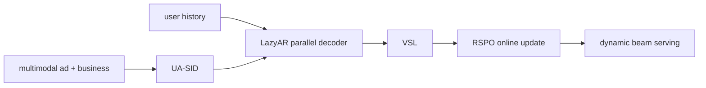
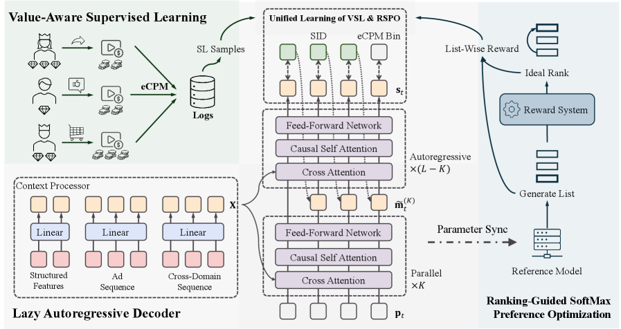

# GR4AD: generative recommendation for large-scale ads

<!-- source-sha256: efdc95f432bf46e72a3eba41fda9fc6002eef8cf09d1eba05574cd8dbb91f472 -->

[简体中文](README.md)

> **Fidelity: core mechanism.** Trains UA-SID, parallel LazyAR, VSL, and list-wise RSPO. Private multimodal ads, eCPM, online continual learning, and dynamic beam serving are not reproduced.

## Paper information

| Field | Details |
|---|---|
| Paper | [arXiv 2602.22732](https://arxiv.org/abs/2602.22732) |
| Organization | Kuaishou |
| First public release | 2026-02-26 (arXiv v1) |
| Authors' code | The paper did not provide official or author code when checked on 2026-08-09. |
| Adapter / method | `gr4ad` |
| Local reproduction code | [`src/auto_research/reproductions/gr4ad/`](https://github.com/daiwk/auto-research/tree/main/src/auto_research/reproductions/gr4ad/) |

## Original paper

### Motivation and method

Generative ad recommendation must meet business-semantics, real-time update, and latency requirements. GR4AD uses multigranularity UA-SID to encode ads, LazyAR to relax dependencies between autoregressive levels, VSL for business-value-weighted supervision, and RSPO to optimize ranked lists directly. Dynamic Beam Serving adjusts beam width with load.

<!-- paper-figure:start -->
### Key figure from the paper

> **Figure 1:** Core architecture, modules, and their connections. From the [original paper](https://arxiv.org/abs/2602.22732); copyright remains with the authors.
<!-- paper-figure:end -->

### Core equations

$L_{VSL}=-w(v_i)\sum_l\log p(c_{i,l}|h)$. Local RSPO uses the reward distribution $q_j\propto e^{r_j/\tau}$ to optimize $L_{RSPO}=-\sum_jq_j\log p_\theta(j|h)$.

### Paper results

LazyAR nearly doubles QPS; off-peak beam can grow 60%. Ad revenue rises up to **+4.2%** over DLRM, with deployment to over 400 million users.

## Local reproduction

> **Local comparison:** Against common DIN, GR4AD NDCG@10 is **+69.67%**. Adding UA-SID/LazyAR/VSL/RSPO to the internal DLRM baseline yields **+49.88%**. Both carry concentration risk, with head share 0.505.

60 steps, 180 users, 280 items, seeds 42–44. Common DIN (100 steps) Hit/NDCG is 0.0481/0.02167; GR4AD is 0.0704/0.03676, NDCG **+69.67%** relative. The internal DLRM ablation gives **+49.88%**. Head share reaches 0.505, showing concentration from the MovieLens popularity value proxy. See the [metrics](metrics/movielens-100k-seeds42-44.json).
