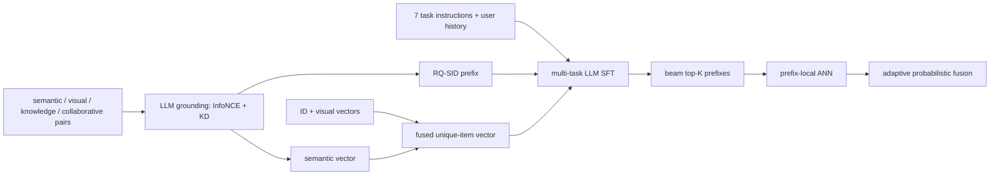
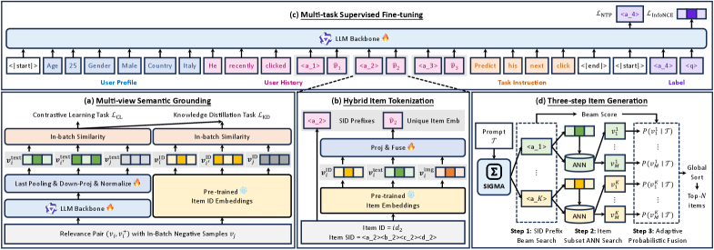

# SIGMA: Semantically Grounded, Instruction-Based Multitask Generative Recommendation

<!-- source-sha256: 2c46dd0013972a90df6273827665c00cc29a334b55535b229fb9821932d96a0d -->

[简体中文](README.md)

> **Fidelity: full core pipeline.** The local run executes causal-LM LoRA with multiview InfoNCE and KD, hybrid RQ-SID-prefix and unique-ID tokens, seven-task instruction SFT, SID-prefix NTP, same-prefix hard-negative InfoNCE, and prefix-beam to local item retrieval and APF. It is not a final-score heuristic.

## Paper information

| Field | Details |
|---|---|
| Paper | [arXiv 2602.22913](https://arxiv.org/abs/2602.22913) |
| Organization | Alibaba / AliExpress |
| First public release | 2026-02-26 (arXiv v1) |
| Authors' code | No official or author implementation is linked by the paper (checked 2026-08-09). |
| Adapter / method | `sigma` |
| Local reproduction code | [`src/auto_research/reproductions/sigma/`](https://github.com/daiwk/auto-research/tree/main/src/auto_research/reproductions/sigma/) |

## Original paper

### Motivation and method

Standard generative recommendation predicts the next item but cannot immediately follow business instructions such as Query, Category, Longtail, Discover, Season, and Holiday. SIGMA aligns LLM semantics with online ID embeddings using search semantics, vision, world knowledge, and collaborative-behavior relevance pairs. Short SID prefixes retain generative efficiency and unique IDs retain item precision. Seven tasks share instruction SFT. Inference generates prefixes with beam search and performs ANN only within their subcatalogs. Adaptive probabilistic fusion (APF) trades off precision and diversity according to the spread of prefix confidences.



<!-- paper-figure:start -->
### Key figure from the paper

[](https://arxiv.org/html/2602.22913v2/x1.png)

> **Figure 1:** Core architecture, its modules, and their connections. From the [original paper](https://arxiv.org/abs/2602.22913); copyright remains with the authors.
<!-- paper-figure:end -->

### Core equations

Multiview relevance pairs use in-batch InfoNCE and distillation from similarity distributions over online ID embeddings:

$$
\mathcal L_{CL}=-\frac1{2B}\sum_i\log P_{text}(i'\mid i),
$$

$$
\mathcal L_{KD}=\sum_{i,j}P_{ID}(j\mid i)\log\frac{P_{ID}(j\mid i)}{P_{text}(j\mid i)}.
$$

Hybrid tokens are $[c_1,\dots,c_\ell,id_i]$. SFT optimizes prefix NTP and item InfoNCE with same-prefix hard negatives:

$$
\mathcal L_{NTP}=-\frac1\ell\sum_t\log P(c_t\mid U,H,I,c_{<t}),
$$

$$
\mathcal L_{ID}=-\log\frac{e^{\cos(h,\tilde v_i)/\tau}}{e^{\cos(h,\tilde v_i)/\tau}+\sum_{j\in N_c}e^{\cos(h,\tilde v_j)/\tau}}.
$$

APF multiplies the prefix beam score $\phi_k$ with the conditional item probability and adjusts temperature with the standard deviation of the top-K prefix scores:

$$
P(v_i\mid T)=P(c^k\mid T)P(id_i\mid T,c^k),
$$

$$
P(id_i\mid T,c^k)\propto\exp(\cos(h_k,\tilde v_i)\,\sigma(\phi_1,\dots,\phi_K)/\tau).
$$

### Paper results

| Paper variant | HR@1 | HR@5 | HR@10 | HR@20 |
|---|---:|---:|---:|---:|
| GR (SID) | 8.01% | 16.17% | 22.41% | 26.41% |
| GR (ID) | 7.31% | 20.15% | 28.98% | 37.37% |
| SIGMA SID1ID→SID1ID | **9.61%** | **24.73%** | **33.76%** | **43.05%** |
| Without semantic grounding | 7.80% | 19.10% | 25.85% | 33.24% |
| Without APF | 9.31% | 22.82% | 30.18% | 37.73% |

Two-week A/B across four AliExpress tasks at 5% traffic: orders +2.80%, CVR +3.84%, GMV +7.84%, and purchase category breadth +2.47%.

## Local reproduction

> **Local comparison.** The baseline is the `id_only` head on the same grounded SmolLM with the same seven-task SFT and fused item vectors; the experiment uses hybrid prefix-to-ID generation. Validation selected `top1_prefix`. Held-out HR@20 rose from 0.0078125 (1/128) to 0.0703125 (9/128), **+800.00%** relative; NDCG@10 rose from 0.003906 to 0.034112 (**+773.27%**). Nine absolute hits do not establish industrial gains.

The local setup uses 12,000 training users, 128 validation users, 128 test users, and the full 3,459-item catalog. It runs 40 multiview grounding steps and 480 seven-task SFT steps. Test data do not select among the three inference modes.

| Local inference | HR@1 | HR@5 | HR@10 | HR@20 | NDCG@10 |
|---|---:|---:|---:|---:|---:|
| id_only (baseline) | 0.00000 | 0.00781 | 0.00781 | 0.00781 | 0.00391 |
| top1_prefix (selected on validation) | **0.01562** | **0.03125** | **0.06250** | **0.07031** | **0.03411** |
| APF top5 prefixes | **0.01562** | **0.03125** | 0.05469 | 0.06250 | 0.03145 |

Hybrid prefixes reduce the item search space, but APF yields 11.11% lower HR@20 than top1-prefix and does not reproduce the paper's APF improvement. The seven task buckets contain only about 18 examples per task; per-task scores are diagnostics.

```bash
AUTO_RESEARCH_SIGMA_GROUNDING_STEPS=40 \
AUTO_RESEARCH_SIGMA_SFT_STEPS=480 \
AUTO_RESEARCH_SIGMA_EVAL_USERS=128 \
auto-research reproduce --paper sigma --seed 42
```

See [stable metrics](metrics/office-seed42.json). MPS training took roughly 3–4 minutes; checkpoints are not committed.

## Reproduction limits

- SmolLM LoRA encoding and backpropagation are real; fixed embeddings do not replace multiview grounding. Items use the Qwen/RQ-SID files from the public benchmark.
- The AliExpress setup of 150M grounding pairs, 130M SFT examples, and 2M evaluation examples is reduced to Office. Queries, seasons, holidays, vision, and world knowledge use deterministic task mappings based on public titles and embeddings.
- Exact cosine top-k over 3,459 items verifies retrieval logic without measuring large-scale ANN latency.
- The experiment supports the hybrid-token search-space mechanism, not APF or online business uplift.
