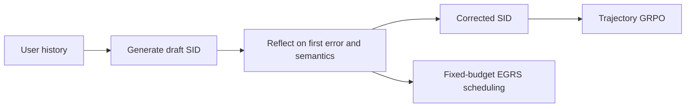
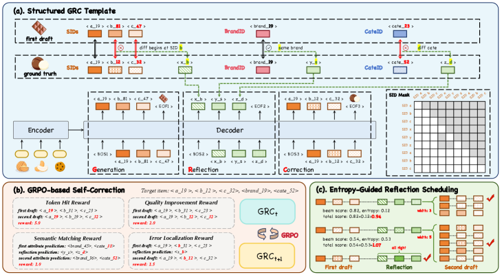

# GRC: generation, reflection, and correction for generative recommendation

<!-- source-sha256: 695239b6696ff0dae13606cb91a491f17c9ac43500716f31bbc198c3987fb7d8 -->

[简体中文](README.md)

> **Fidelity: core mechanism.** Runs structured SFT, full-trajectory GRPO, and entropy-guided reflection scheduling.

## Paper information

| Field | Details |
|---|---|
| Paper | [arXiv 2602.23639](https://arxiv.org/abs/2602.23639) |
| Organization | Alibaba International / Wuhan University |
| First public release | 2026-02-27 (arXiv v1) |
| Authors' code | The paper did not provide official or author code when checked on 2026-08-09. |
| Adapter / method | `grc` |
| Local reproduction code | [`src/auto_research/reproductions/grc/`](https://github.com/daiwk/auto-research/tree/main/src/auto_research/reproductions/grc/) |

## Original paper

### Motivation and method

Early errors in autoregressive semantic-ID generation can propagate. GRC structures a draft SID, reflection on the first error and attribute consistency, and a corrected SID. It applies GRPO to whole trajectories and allocates a fixed correction budget to the most uncertain beams using reflection-token entropy.



<!-- paper-figure:start -->
### Key figure from the paper

[](https://arxiv.org/html/2602.23639v1/x2.png)

> **Figure 2:** Core architecture, modules, and their connections. From the [original paper](https://arxiv.org/abs/2602.23639); copyright remains with the authors.
<!-- paper-figure:end -->

### Core equations

$$
r_{loc}=\min\big(\{t:\hat z_t\ne z_t^{gt}\}\cup\{L+1\}\big),\qquad \mathcal L_{SFT}=\mathcal L_{MLE}+\lambda_{rc}\mathcal L_{rc}.
$$

$$
\operatorname{score}_{EGRS}=\operatorname{score}_{base}+\alpha_e\bar H^{ref}.
$$

### Paper results

From 2026-01-02 through January 12, with 15% traffic per arm, revenue rose `+1.79%`, CTR `+2.11%`, and GMV `+2.04%`, all significant.

## Local reproduction

> **Local comparison:** The baseline is the GR backbone with the same SID. GRC adds 1,320 structured trajectories, 10 GRPO rounds, and EGRS. Relative Hit@10 is **-12.50%** and NDCG@10 **-11.12%**.

Mean GRPO reward rises `8.3989→8.4273` while full-catalog test ranking degrades. See the [stable metrics](metrics/movielens-100k-seed42.json).

```bash
auto-research reproduce --paper grc --seed 42
```

## Reproduction boundaries

MovieLens genre stands in for category, seller, and brand. Industrial LLM parameter scale is not reproduced.
