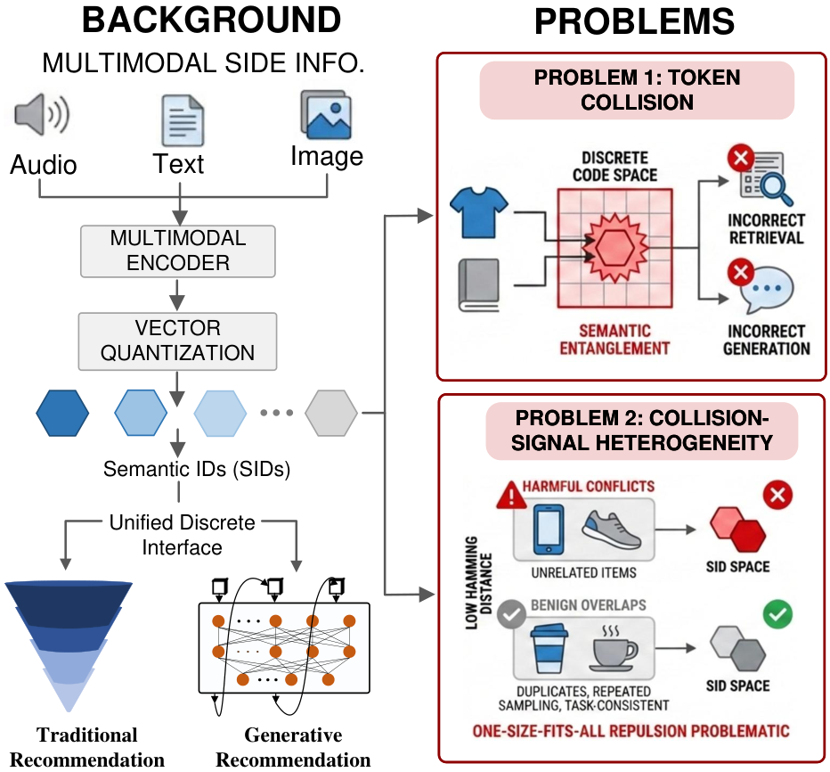

# Stop Treating Collisions Equally: Qualification-Aware Semantic ID Learning for Recommendation at Industrial Scale

<!-- source-sha256: 977beaa669a3d636e09b93c11313942db3ad3cc49e0c533c0a06d6fa50af69d5 -->

[简体中文](README.md)

> **Fidelity: core mechanism.** Paper online outcomes, local public-data results, and omissions are separate.

## Paper information

| Field | Details |
|---|---|
| Paper | [arXiv 2603.00632](https://arxiv.org/abs/2603.00632) |
| Organization | University of Electronic Science and Technology of China / Kuaishou |
| First public release | 2026-02-28 (arXiv v1) |
| Authors' code | The paper did not provide official or author code when checked on 2026-08-24. |
| Adapter / method | `quasid` |
| Local reproduction code | [`src/auto_research/reproductions/quasid/`](https://github.com/daiwk/auto-research/tree/main/src/auto_research/reproductions/quasid/) |

## Original paper

### Motivation and method

Use business qualifications to set collision-pair margins rather than repelling every pair equally. Items with sparse feedback or cold starts receive more distinguishable semantic IDs.


<!-- paper-figure:start -->
### Key figure from the paper

[](https://arxiv.org/html/2603.00632v1/illustration_v4.png)

> **Figure 1:** Overview of the paper's method and key components. From the [original paper](https://arxiv.org/abs/2603.00632); copyright remains with the authors.
<!-- paper-figure:end -->

### Core equations

$$
L_{qual}=\sum_{ij}q_{ij}[m_{ij}-d(z_i,z_j)]_+
$$

### Paper results

Online **GMV-S2 +2.38%** with 5% traffic for five days (Section 5.4). The private paper protocol is not directly comparable with local MovieLens measurements.

## Local reproduction

> **Local comparison:** The baseline is the shared transition + content scorer. The treatment adds only quasid on the same users, items, full-catalog candidates, and seed.

MovieLens-100K, 220 users and 360 items, seed 42: NDCG@10 0.0540 → **0.0537 (-0.55%)**; Hit@10 0.1091 → 0.0909. Validation selects mixture weights only; the test set is not used for tuning.

```bash
auto-research reproduce --paper quasid --dataset-dir data --seed 42
```

See the [fixed metrics](metrics/public-seed42.json).

## Reproduction boundaries

The core mechanism runs on MovieLens-100K with the same split, fixed full-catalog candidates, and seed. Private features, the production foundation model, and online traffic are unavailable. The implementation has independent model state and scoring and retains negative results. Local changes and paper A/B gains are reported separately.
