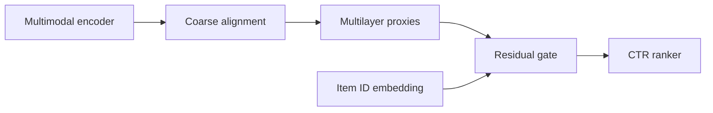
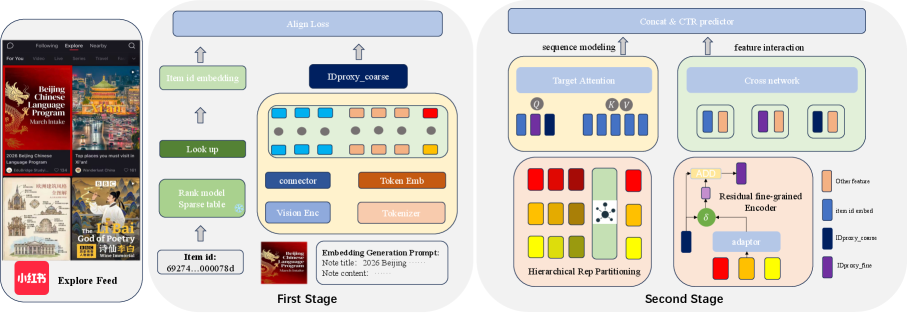

# IDProxy: Aligning Multimodal LLM Representations with Item IDs

<!-- source-sha256: 49e3db479066d6d4a373377a38b07d967de79e7c6023137a0268290bbc9ce2d7 -->

[简体中文](README.md)

> **Local core-mechanism evidence.** Paper outcomes and local results are separate.

## Paper information

| Field | Value |
| --- | --- |
| Paper | [arXiv 2603.01590](https://arxiv.org/abs/2603.01590) |
| Affiliations | Xiaohongshu / Shanghai Jiao Tong University / Fudan University |
| First public release | 2026-03-02 (arXiv v1) |
| Authors' code | No official author code linked as of 2026-08-09. |
| Adapter / method | `idproxy` |
| Local code | [`src/auto_research/reproductions/idproxy/`](https://github.com/daiwk/auto-research/tree/main/src/auto_research/reproductions/idproxy/) |

## Original paper

### Background and contribution

Multimodal semantics differ from long-learned collaborative item-ID space. Contrastive coarse alignment precedes multilayer hidden-state proxies, injected into the ranker through a residual gate.



<!-- paper-figure:start -->
### Key figure from the paper

[](https://arxiv.org/html/2603.01590v1/x3.png)

Original Figure 2: IDProxy. From the [paper](https://arxiv.org/abs/2603.01590); copyright belongs to the authors. Not a local result.
<!-- paper-figure:end -->

### Core mechanism

$$
\mathcal L_{\rm PAL}=-\log\frac{\exp(z_i^\top e_i/\tau)}
{\sum_j\exp(z_i^\top e_j/\tau)},\qquad
\tilde e_i=e_i+\sigma(g_i)\operatorname{Adapter}(z_i).
$$

### Paper results

Feed duration +0.22%, reads +0.39%, interaction +0.50%; ad impressions +1.28%, ADVV +1.93%, COST +1.73% in the paper.

## Local reproduction

MovieLens genres proxy content. Project into bidirectional transition ID space and apply multilayer nonlinear proxies and gating. ID-only versus IDProxy: 40-step contrastive loss 6.073→5.358; NDCG@10 0.03540→0.03728 (+5.32%), in `metrics/movielens-100k-seed42.json`.

```bash
auto-research reproduce --paper idproxy --dataset-dir data --seed 42
```

## Reproduction limits

Core coarse-to-fine and gating only; no InternVL or private image/text data.
