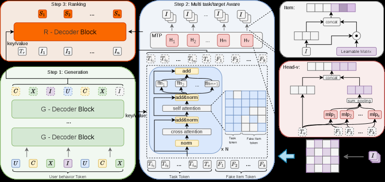

# OneRanker: Unified Generation and Ranking with One Model in Industrial Advertising Recommendation

<!-- source-sha256: 1a4f51517cd72ba2a34201355c96753b2b67d1bc5cc5320d341d9feeaf0dffbf -->

[简体中文](README.md)

> Core public-data ranking mechanism.

## Paper information

| Field | Details |
|---|---|
| Paper | [Paper or original source](https://arxiv.org/abs/2603.02999) |
| Institution | Tencent. |
| First public release | 2026-03-03 (arXiv v1) |
| Author code | No official author code linked by the paper as checked on 2026-08-09. |
| Local adapter or method key | `oneranker` |
| Local reproduction code | [`src/auto_research/reproductions/oneranker/`](https://github.com/daiwk/auto-research/tree/main/src/auto_research/reproductions/oneranker/) |

## Paper method and evidence

Use a fake item token to unify generation, click-value estimation and ad ranking. Distribution consistency aligns generated probability with the value head.


<!-- paper-figure:start -->
### Original paper figure

[](https://arxiv.org/html/2603.02999v3/x2.png)

Figure shows one model for generation and ranking. From the [original paper](https://arxiv.org/abs/2603.02999); copyright remains with the authors.
<!-- paper-figure:end -->

### Core equation

$$
\mathcal L=\mathcal L_{gen}+\lambda_v\mathcal L_{value}+\lambda_cD_{KL}(p_{gen}\Vert p_{rank}).
$$

### Reported results

Full WeChat Channels ad rollout reports GMV +1.34%.

## Local reproduction

MovieLens-100K full catalog, 260 users/420 items, seed 42: shared transition+content scorer versus adding OneRanker only, NDCG@10 **0.0354→0.0327 (-7.65%)**. [Fixed metrics](metrics/public-seed42.json). No private logs, traffic, checkpoints or production serving; local results do not reproduce paper lift.

```bash
auto-research reproduce --paper oneranker --dataset-dir data --seed 42
auto-research evolve --model rankmixer --dataset movielens-100k --direction "Combine oneranker with installed paper operators" --generations 2 --population 4
```
