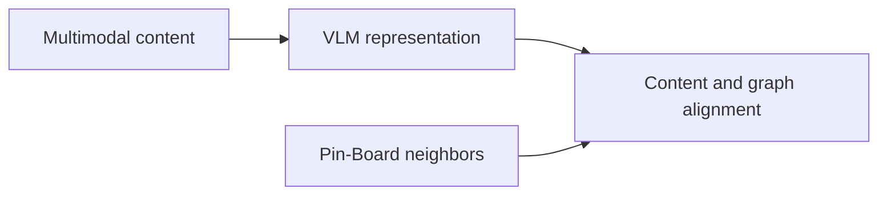
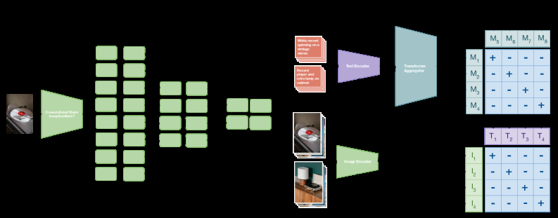

# PinCLIP: Pinterest Multimodal Foundation Representations

<!-- source-sha256: 26fcfade3c9f0225e54d0a492214b33c03b10ed6b0041b67f17c5383593a0575 -->

[简体中文](README.md)

> **Core mechanism evidence.** Paper and local evaluation are separate.

## Paper information

| Field | Value |
| --- | --- |
| Paper | [arXiv 2603.03544](https://arxiv.org/abs/2603.03544) |
| Affiliations | Pinterest |
| First public release | 2026-03-03 (arXiv v1) |
| Authors' code | No official author code linked as of 2026-08-09. |
| Adapter / method | `pinclip` |
| Local code | [`src/auto_research/reproductions/pinclip/`](https://github.com/daiwk/auto-research/tree/main/src/auto_research/reproductions/pinclip/) |

## Original paper

### Background and contribution

General VLM training does not match recommendation, and fresh content lacks behavior. PinCLIP combines multigranular image/text signals with Pin–Board graph-neighbor alignment.



<!-- paper-figure:start -->
### Key figure from the paper

[](https://arxiv.org/html/2603.03544v1/x1.png)

Original Figure 1: PinCLIP. From the [paper](https://arxiv.org/abs/2603.03544); copyright belongs to the authors. Not a local result.
<!-- paper-figure:end -->

### Core mechanism

$$
\mathcal L=\mathcal L_{\mathrm{image\text{-}text}}
+\lambda\mathcal L_{\mathrm{neighbor}},\qquad
\mathcal L_{\mathrm{neighbor}}
=-\log\frac{e^{z_i^\top z_j/\tau}}{\sum_k e^{z_i^\top z_k/\tau}}.
$$

### Paper results

Paper multimodal retrieval +20% over Qwen, fresh organic repin +15%, new Ads click +8.7%.

## Local reproduction

Raw genre/content similarity versus learned content/co-occurrence canonical alignment: NDCG@10 0.03540→0.03490 (−1.41%). [Metrics](metrics/movielens-seed42.json).

```bash
auto-research reproduce --paper pinclip --dataset-dir data --seed 42
```

## Reproduction limits

Sparse genres cannot substitute for image/text VLM, pixels, pretraining, or full Pinterest graph; the negative proxy result does not invalidate the paper.
