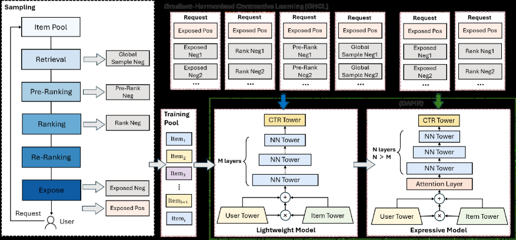

# HAP: Not All Candidates are Created Equal — Heterogeneity-Aware Pre-ranking

<!-- source-sha256: 4ec750359dc4d37bf5dc48f1a8ecf2aad377bc6d7150fe162eb0c6daeccf4e16 -->

[简体中文](README.md)

> Core public-data pre-ranking mechanism.

## Paper information

| Field | Details |
|---|---|
| Paper | [Paper or original source](https://arxiv.org/abs/2603.03770) |
| Institution | ByteDance / Toutiao. |
| First public release | 2026-03-04 (arXiv v1) |
| Author code | [Toutiao-Rec/HAP](https://github.com/Toutiao-Rec/HAP). |
| Local adapter or method key | `hap` |
| Local reproduction code | [`src/auto_research/reproductions/hap/`](https://github.com/daiwk/auto-research/tree/main/src/auto_research/reproductions/hap/) |

## Paper method and evidence

Route candidates to lightweight or strong pre-ranking by difficulty. Cross-branch harmonization keeps ranking scales comparable across compute budgets.


<!-- paper-figure:start -->
### Original paper figure

[](https://arxiv.org/html/2603.03770v1/x2.png)

Figure shows heterogeneous branches and harmonization. From the [original paper](https://arxiv.org/abs/2603.03770); copyright remains with the authors.
<!-- paper-figure:end -->

### Core equation

$$
s_i=g_i f_{strong}(x_i)+(1-g_i)f_{light}(x_i),\quad\mathcal L=\mathcal L_{rank}+\lambda\mathcal L_{harm}.
$$

### Reported results

Nine months of Toutiao deployment: usage duration +0.4%, active days +0.05%.

## Local reproduction

MovieLens-100K full catalog, 260 users/420 items, seed 42: shared transition+content baseline vs HAP **0.0354→0.0371 NDCG@10 (+4.90%)**.

```bash
auto-research reproduce --paper hap --dataset-dir data --seed 42
auto-research evolve --model rankmixer --dataset movielens-100k --direction "Combine hap with installed paper operators" --generations 2 --population 4
```

[Fixed metrics](metrics/public-seed42.json). No private features, production traffic or serving. These local public-data results do not reproduce online lift.
