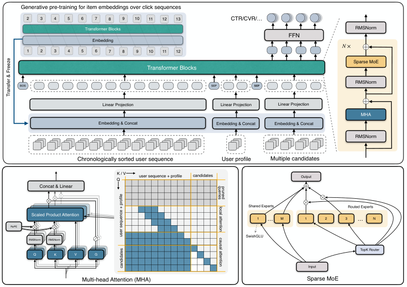

# SORT: A Systematically Optimized Ranking Transformer for Industrial-scale Recommenders

<!-- source-sha256: b9aa6346827644ea4b96a7a4e2c0f00c2262ebe6a2e7e258e708af82ff94ff74 -->

[简体中文](README.md)

> Core public ranking mechanism.

## Paper information

| Field | Details |
|---|---|
| Paper | [Paper or original source](https://arxiv.org/abs/2603.03988) |
| Institution | Alibaba International Digital Commerce. |
| First public release | 2026-03-04 (arXiv v1) |
| Author code | No official author code linked by the paper as checked on 2026-08-24. |
| Local adapter or method key | `sort-ranking` |
| Local reproduction code | [`src/auto_research/reproductions/sort_ranking/`](https://github.com/daiwk/auto-research/tree/main/src/auto_research/reproductions/sort_ranking/) |

## Paper method and evidence

Redesign feature tokenization, attention and FFN, with hardware-oriented long-sequence compression so one Transformer replaces a traditional DLRM.


<!-- paper-figure:start -->
### Original paper figure

[](https://arxiv.org/html/2603.03988v2/sort_arch.png)

Figure shows hardware-aware ranking architecture. From the [original paper](https://arxiv.org/abs/2603.03988); copyright remains with the authors.
<!-- paper-figure:end -->

### Core equation

$$
H'=H+\operatorname{MHA}(H),\quad H''=H'+\operatorname{FFN}(H')
$$

### Reported results

Section 4.7/Table 5 reports **orders +6.35%** across three production scenarios.

## Local reproduction

MovieLens-100K, 220 users/360 items, seed 42, same split/candidates: shared transition+content baseline vs independent SORT state and scorer. NDCG@10 **0.0540→0.0469 (-13.11%)**, Hit@10 **0.1091→0.0909**. Validation selects blend; test never tunes.

```bash
auto-research reproduce --paper sort-ranking --dataset-dir data --seed 42
```

[Fixed metrics](metrics/public-seed42.json). No private features, production traffic or serving. These local public-data results do not reproduce online lift.
