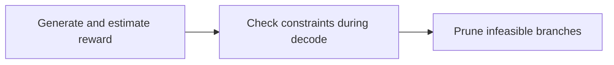
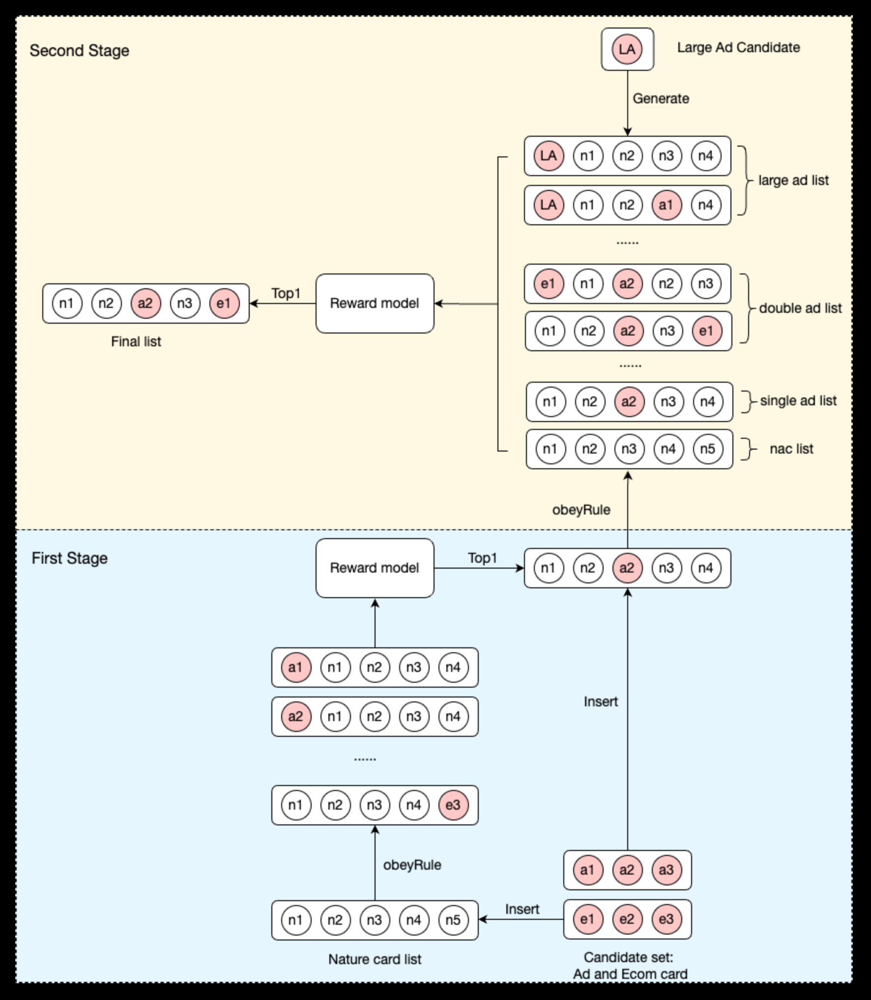

# CGR: Constraint-aware generative reranking

<!-- source-sha256: e42bfa4686c88594fa72728b6c2c431fb27b3f6516b7b67cbb51872aab25eb45 -->

[简体中文](README.md)

> Core public-data constraint mechanism.

## Paper information

| Field | Details |
|---|---|
| Paper | [Paper or original source](https://arxiv.org/abs/2603.04227) |
| Institution | Bilibili. |
| First public release | 2026-03-04 (arXiv v1) |
| Author code | No public author code found as of 2026-09-05. |
| Local adapter or method key | `cgr` |
| Local reproduction code | [`src/auto_research/reproductions/cgr/`](https://github.com/daiwk/auto-research/tree/main/src/auto_research/reproductions/cgr/) |

## Paper method and evidence

One network generates the sequence and estimates reward. Encode slot and ad-load rules in autoregressive decoding, and prune infeasible branches early rather than repairing output afterward.



<!-- paper-figure:start -->
### Original paper figure

[](https://arxiv.org/html/2603.04227v1/inference_pipeline.png)

Figure shows constraint-aware reward pruning. From the [original paper](https://arxiv.org/abs/2603.04227); copyright remains with the authors.
<!-- paper-figure:end -->

### Core equation

$$
y_t=\arg\max_{i\in\mathcal F(y_{<t})}\left[s_\theta(i|y_{<t})+\lambda^\top r(i)\right].
$$

### Reported results

The paper reports revenue and engagement gains with business constraints met and over **85%** lower inference latency on millions of daily ad requests.

## Local reproduction

```bash
auto-research reproduce --paper cgr --dataset-dir data --seeds 42,43,44
```

MovieLens-1M fixed catalog: NDCG@10 **0.05401→0.05715 (+5.82%)**. [Three-seed metrics, mean, SD and 95% CI](metrics/public-seeds42-44.json). No private features, production traffic or serving. These local public-data results do not reproduce online lift.
