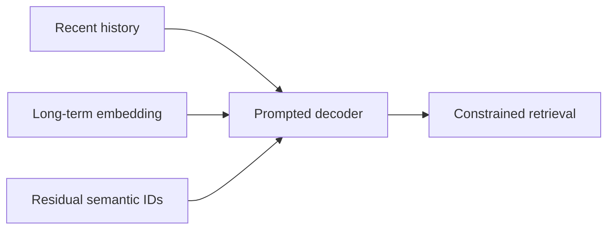
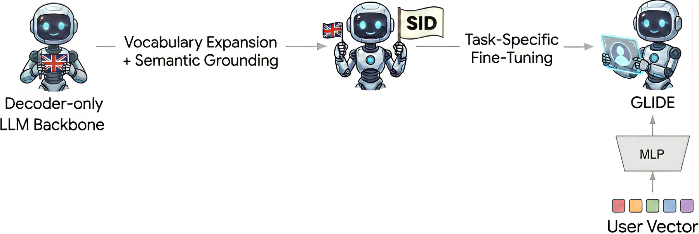

# GLIDE: Generative Retrieval with Short- and Long-Term Interests

<!-- source-sha256: 7376120cf0ac6dccb75273ab29ca84ac864648b02cacdd1a0f8e402831f58f72 -->

[简体中文](README.md)

> Autoregressive residual semantic IDs and two prompt timescales run.

## Paper information

| Field | Value |
| --- | --- |
| Paper | [arXiv 2603.17540](https://arxiv.org/abs/2603.17540) |
| Affiliations | Spotify |
| First public release | 2026-03-18 (arXiv v1) |
| Authors' code | No official author code linked as of 2026-08-09. |
| Adapter / method | `glide` |
| Local code | [`src/auto_research/reproductions/glide/`](https://github.com/daiwk/auto-research/tree/main/src/auto_research/reproductions/glide/) |

## Original paper

### Background and contribution

Recent-only histories retrieve habitual content. Generate item IDs conditioned on recent behavior and a long-term user embedding, balancing immediate intent and discovery.



<!-- paper-figure:start -->
### Key figure from the paper

[](https://arxiv.org/html/2603.17540v1/figures/final_steps_upscaled.png)

Original Figure 1: GLIDE. From the [paper](https://arxiv.org/abs/2603.17540); copyright belongs to the authors. Not a local result.
<!-- paper-figure:end -->

### Core mechanism

$$
p(c_{1:L}\mid h_{\rm recent},u_{\rm long})
=\prod_{\ell=1}^L p(c_\ell\mid c_{<\ell},h_{\rm recent},u_{\rm long}).
$$

### Paper results

Spotify's live experiment reports +5.4% non-habitual streaming and +14.3% new-show discovery.

## Local reproduction

Three-level residual quantization uses public item features, with code transitions and short/long profiles. Traditional transition/content retrieval gives NDCG@10 0.03540 versus 0.03437 (−2.89%) for dual-prompt retrieval; see `metrics/movielens-100k-seed42.json`.

```bash
auto-research reproduce --paper glide --dataset-dir data --seed 42
```

## Reproduction limits

The public-data regression is not the Spotify production result.
