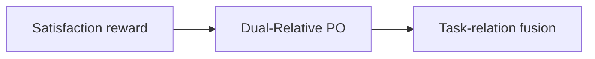
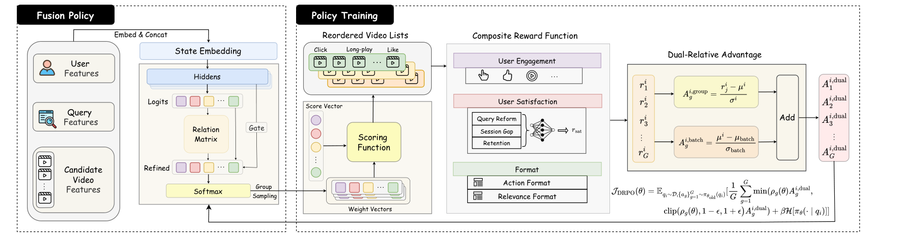

# SaFRO: Satisfaction-Aware Fusion via Dual-Relative Policy Optimization for Short-Video Search

<!-- source-sha256: 1d30d423ae7a65fc612486b6877c316330bf757bb62687200337dce5772ba40c -->

[简体中文](README.md)

> **Fidelity: core mechanism.** Paper online outcomes, local public-data results, and omissions are separate.

## Paper information

| Field | Details |
|---|---|
| Paper | [arXiv 2603.19585](https://arxiv.org/abs/2603.19585) |
| Organization | Kuaishou Technology |
| First public release | 2026-03-20 (arXiv v1) |
| Authors' code | The paper did not provide official or author code when checked on 2026-08-24. |
| Adapter / method | `safro` |
| Local reproduction code | [`src/auto_research/reproductions/safro/`](https://github.com/daiwk/auto-research/tree/main/src/auto_research/reproductions/safro/) |

## Original paper

### Motivation and method

Satisfaction reward models immediate engagement and long-term retention. Dual-Relative PO normalizes advantages within groups and across tasks; relation gating fuses search objectives.



<!-- paper-figure:start -->
### Key figure from the paper

[](https://arxiv.org/html/2603.19585v2/safro.png)

> **Figure 2:** Core architecture, modules, and connections. From the [original paper](https://arxiv.org/abs/2603.19585); copyright remains with the authors.
<!-- paper-figure:end -->

### Core equations

$$
A_{i,t}=\frac{r_{i,t}-\mu_t}{\sigma_t+\epsilon}+\frac{r_{i,t}-\mu_i}{\sigma_i+\epsilon}
$$

### Paper results

Online watch time rises **+0.61%** over two months at 10% traffic (Section 5.4, Table 3). The private paper protocol is not directly comparable with local MovieLens measurements.

## Local reproduction

> **Local comparison:** The baseline is the shared transition + content scorer. The treatment adds only safro on the same users, items, full-catalog candidates, and seed.

MovieLens-100K, 220 users and 360 items, seed 42: NDCG@10 0.0540 → **0.0982 (+81.86%)**; Hit@10 0.1091 → 0.1545. Validation selects mixture weights only; the test set is not used for tuning.

```bash
auto-research reproduce --paper safro --dataset-dir data --seed 42
```

See the [fixed metrics](metrics/public-seed42.json).

## Reproduction boundaries

The core mechanism runs on MovieLens-100K with the same split, fixed full-catalog candidates, and seed. Private features, the production foundation model, and online traffic are unavailable. The implementation has independent model state and scoring and retains negative results. Local changes and paper A/B gains are reported separately.
