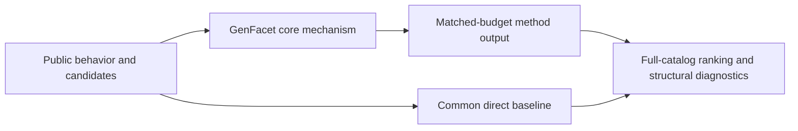
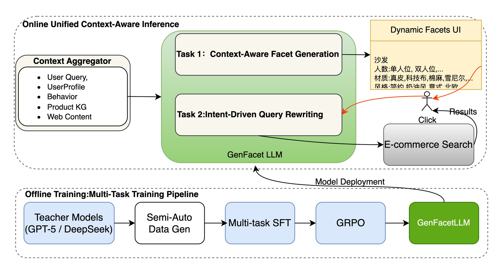

# GenFacet: end-to-end generative faceted search

<!-- source-sha256: 9fba5f218ea628c2b429726ce03fd812e1efb09b14becdb2ec2bbf600e71b40a -->

[简体中文](README.md)

> **Fidelity: core mechanism.** Runs the defining mechanism verifiable on public data. Private data, production models, and serving remain outside scope.

## Paper information

| Field | Details |
|---|---|
| Paper | [arXiv 2603.19665](https://arxiv.org/abs/2603.19665) |
| Organization | JD.com |
| First public release | 2026-03-20 (arXiv v1) |
| Authors' code | No public author code was found on 2026-09-05. |
| Adapter / method | `genfacet` |
| Local reproduction code | [`src/auto_research/reproductions/genfacet/`](https://github.com/daiwk/auto-research/tree/main/src/auto_research/reproductions/genfacet/) |

## Original paper

### Motivation and method

Unify e-commerce faceted search as contextual facet generation and intent-driven query rewriting. Teacher distillation and multi-task GRPO preference alignment optimize downstream search satisfaction directly, linking facet selection to retrieval.



<!-- paper-figure:start -->
### Key figure from the paper

[](https://arxiv.org/html/2603.19665v1/images/Figure_overview.jpg)

> **Figure 1:** Overview of the paper's method and key components. From the [original paper](https://arxiv.org/abs/2603.19665); copyright remains with the authors.
<!-- paper-figure:end -->

### Core equations

$$
\max_\pi\;\mathbb E[r_{facet}+\lambda r_{retrieval}]-\beta D_{KL}(\pi\Vert\pi_{ref}).
$$

### Paper results

JD.com's online A/B test reports facet CTR +42.0% and user conversion +2.0%. This is paper evidence, not a local public-data outcome.

## Local reproduction

> **Local comparison:** Under the same full-catalog protocol, baseline NDCG@10 is 0.05401 and GenFacet NDCG@10 is 0.05171, **-4.26%** relative. The local proxy does not extrapolate to online lift.

See the [three-seed artifact](metrics/public-seeds42-44.json) for complete results, means, standard deviations, and 95% confidence intervals.

```bash
auto-research reproduce --paper genfacet --dataset-dir data --seeds 42,43,44
```

## Reproduction boundaries

The local run uses a public MovieLens-1M subset and auditable proxies to validate the core computation. It does not reproduce private logs, production models, online traffic assignment, or serving. No claim is made to reproduce absolute paper metrics or online gains.
