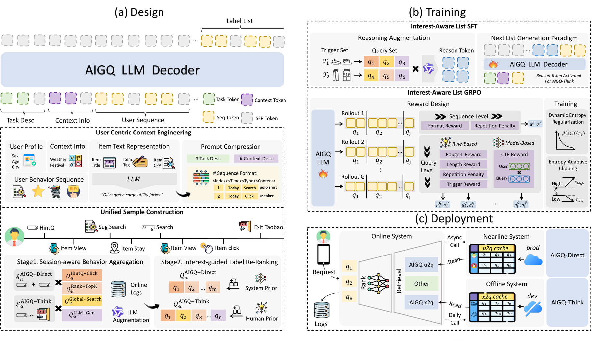

# AIGQ: An End-to-End Hybrid Generative Architecture for E-commerce Query Recommendation

<!-- source-sha256: ebb0ef9879fa1cc3ea62511afe500584b8bbfe218634ab8d2c458802a6b642f6 -->

[简体中文](README.md)

> **Fidelity: core mechanism.** Paper online evidence, public-data experiments, and omissions are separate.

## Paper information

| Field | Details |
|---|---|
| Paper | [arXiv 2603.19710](https://arxiv.org/abs/2603.19710) |
| Organization | Taobao & Tmall Group / Alibaba |
| First public release | 2026-03-20 (arXiv v1) |
| Authors' code | The paper did not provide official or author code when checked on 2026-08-24. |
| Adapter / method | `aigq` |
| Local reproduction code | [`src/auto_research/reproductions/aigq/`](https://github.com/daiwk/auto-research/tree/main/src/auto_research/reproductions/aigq/) |

## Original paper

### Motivation and method

The Direct path keeps latency low and the Reasoning path handles complex intent. IL-GRPO optimizes whole query sets with online CTR reward, using hybrid offline and online serving.


<!-- paper-figure:start -->
### Key figure from the paper

[](https://arxiv.org/html/2603.19710v1/Arch_Final.png)

> **Figure 2:** Core architecture, modules, and connections. From the [original paper](https://arxiv.org/abs/2603.19710); copyright remains with the authors.
<!-- paper-figure:end -->

### Core equation

$$
J=\mathbb E[R(Q)]-\beta D_{KL}(\pi_\theta\|\pi_{ref})
$$

### Paper results

The paper reports **GMV +10.68%** in a thirty-day online A/B test (Section 5.4). Its private protocol is not directly comparable with local MovieLens metrics.

## Local reproduction

> **Local comparison:** The baseline is the shared transition + content scorer. Adding only `aigq` on the same users, items, full catalog, and seed yields +8.09% relative NDCG@10.

MovieLens-100K, 220 users and 360 items, seed 42: NDCG@10 0.0540 → **0.0584 (+8.09%)**, Hit@10 0.1091 → 0.1136. Validation only selects mixture weights; test does not tune.

```bash
auto-research reproduce --paper aigq --dataset-dir data --seed 42
```

See the [fixed metrics](metrics/public-seed42.json).

## Reproduction boundaries

The local core mechanism uses fixed full-catalog candidates, a shared MovieLens-100K split, and a shared seed. Private features, production models, and online traffic are unavailable. The implementation has independent model state and scoring, retains negatives, and separates local changes from paper A/B gains.
