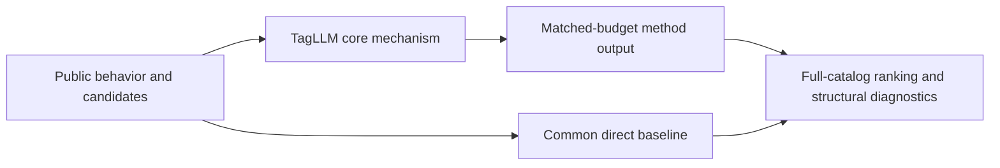
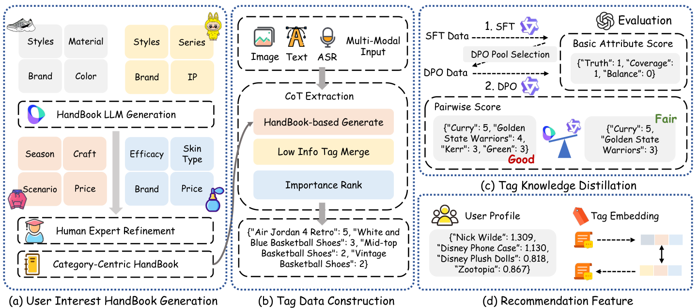

# TagLLM: fine-grained post tag generation

<!-- source-sha256: d3d1b2a413c146c841340eec2c9d9d48a3288f06f644333eac127c3e68dc2682 -->

[简体中文](README.md)

> **Fidelity: core mechanism.** Runs the defining mechanism verifiable on public data. Private data, production models, and serving remain outside scope.

## Paper information

| Field | Details |
|---|---|
| Paper | [arXiv 2603.21481](https://arxiv.org/abs/2603.21481) |
| Organization | Tongji University |
| First public release | 2026-03-23 (arXiv v1) |
| Authors' code | No public author code was found on 2026-09-05. |
| Adapter / method | `tagllm` |
| Local reproduction code | [`src/auto_research/reproductions/tagllm/`](https://github.com/daiwk/auto-research/tree/main/src/auto_research/reproductions/tagllm/) |

## Original paper

### Motivation and method

Build a user-interest handbook by post category. Multimodal chain-of-thought extracts fine-grained tags by interest dimension. Two-stage knowledge distillation transfers tagging to a smaller model for explainability and serving efficiency.



<!-- paper-figure:start -->
### Key figure from the paper

[](https://arxiv.org/html/2603.21481v1/method_pipeline.png)

> **Figure 2:** Overall workflow, key stages, and data flow. From the [original paper](https://arxiv.org/abs/2603.21481); copyright remains with the authors.
<!-- paper-figure:end -->

### Core equations

$$
\mathcal L=\mathcal L_{tag}+\lambda\,D_{KL}\!\left(p_{teacher}(y|x,H)\Vert p_{student}(y|x)\right).
$$

### Paper results

Online A/B reports watch time per user +0.31%, interactions +0.96%, and cold-start PV CTR +32.37%. This is paper evidence, not a local public-data outcome.

## Local reproduction

> **Local comparison:** Under the same full-catalog protocol, baseline NDCG@10 is 0.05401 and TagLLM NDCG@10 is 0.05147, **-4.69%** relative. The local proxy does not extrapolate to online lift.

See the [three-seed artifact](metrics/public-seeds42-44.json) for complete results, means, standard deviations, and 95% confidence intervals.

```bash
auto-research reproduce --paper tagllm --dataset-dir data --seeds 42,43,44
```

## Reproduction boundaries

The local run uses a public MovieLens-1M subset and auditable proxies to validate the core computation. It does not reproduce private logs, production models, online traffic assignment, or serving. No claim is made to reproduce absolute paper metrics or online gains.
