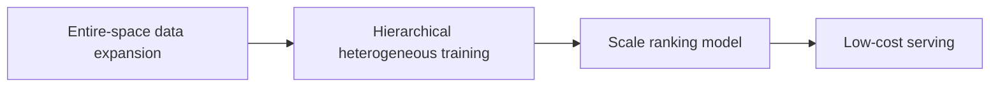
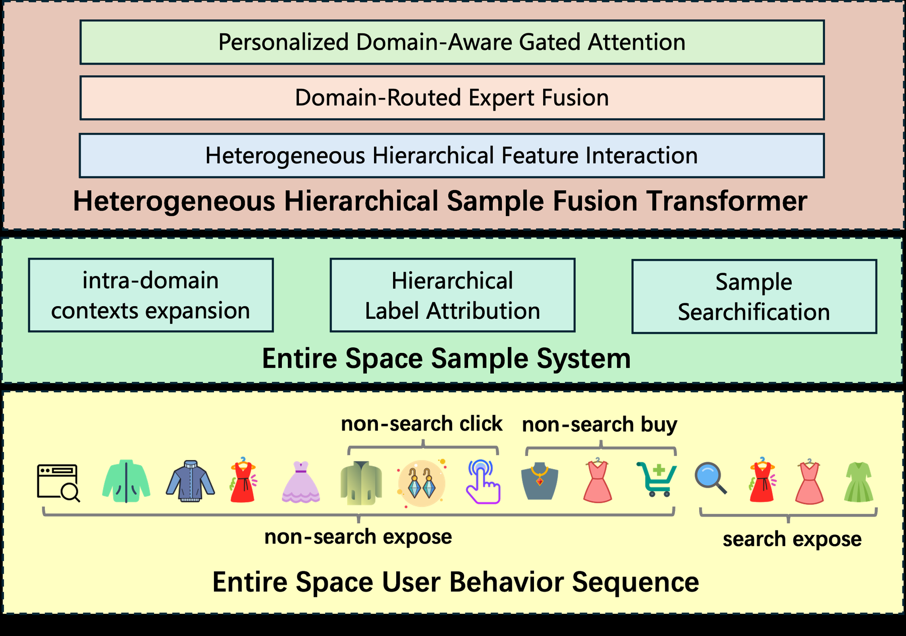

# UniScale: Synergistic Entire Space Data and Model Scaling for Search Ranking

<!-- source-sha256: 367a69ace49a06d9575fb134cc113bf80aa2eefd98a7d98e3a8db6639a48dfa4 -->

[简体中文](README.md)

> Core public-data mechanism, separate from online evidence.

## Paper information

| Field | Details |
|---|---|
| Paper | [arXiv 2603.24226](https://arxiv.org/abs/2603.24226) |
| Institution | Taobao & Tmall Group / Alibaba. |
| First public release | 2026-03-25 (arXiv v1) |
| Author code | No official author code linked by the paper as checked on 2026-08-24. |
| Local adapter or method key | `uniscale` |
| Local reproduction code | [`src/auto_research/reproductions/uniscale/`](https://github.com/daiwk/auto-research/tree/main/src/auto_research/reproductions/uniscale/) |

## Paper method and evidence

ES³ expands training beyond exposed items; HHSFT hierarchically combines heterogeneous examples. Scale data and model capacity jointly with low-cost deployment.



<!-- paper-figure:start -->
### Original paper figure

[](https://arxiv.org/html/2603.24226v4/overview.png)

The original figure shows joint data/model scaling. From the [original paper](https://arxiv.org/abs/2603.24226); copyright remains with the authors.
<!-- paper-figure:end -->

### Core equation

$$
h^{l+1}=h^l+\sum_d g_d(h^l)\,FFN_d(h^l)
$$

### Reported results

Section 4.5 reports **GMV +2.04%** at 5% traffic for ten days; not comparable with MovieLens.

## Local reproduction

Shared transition + content scorer vs independent UniScale core on matched MovieLens-100K 220 users/360 items, full-catalog candidates and seed 42. NDCG@10 **0.0540→0.0528 (-2.20%)**; Hit@10 **0.1091→0.1045**. Validation selects only blend weight; test does not tune.

```bash
auto-research reproduce --paper uniscale --dataset-dir data --seed 42
```

[Fixed metrics](metrics/public-seed42.json). Independent model state and scoring execute; no private features, production foundation model or online traffic. The negative result is retained.
