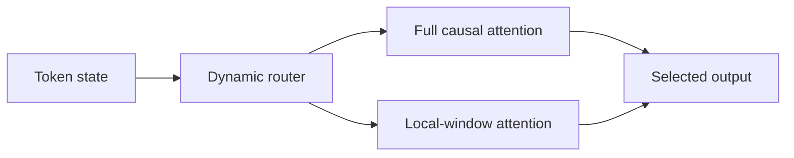
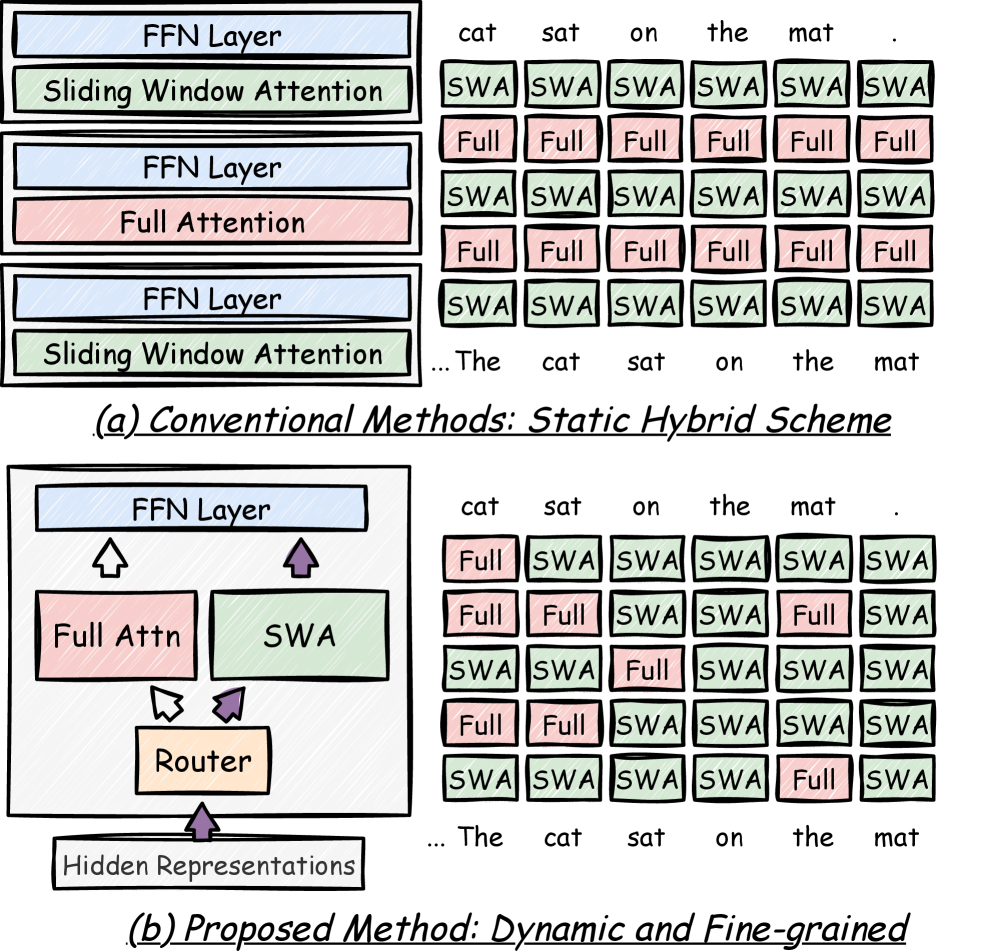

# Switch Attention

<!-- source-sha256: 9f8955eab46af4cf9a1d47d4af3a8c4ae23605219af2294653cfe74db4f3579e -->

[简体中文](README.md)

> Core token-level learned full/local router.

## Paper information

| Field | Value |
| --- | --- |
| Paper | [arXiv 2603.26380](https://arxiv.org/abs/2603.26380) |
| Affiliations | Peking University / Huawei Technologies |
| First public release | 2026-03-27 (arXiv v1) |
| Authors' code | No official author code linked as of 2026-08-09. |
| Adapter / method | `switch-attention` |
| Local code | [`src/auto_research/reproductions/switch_attention/`](https://github.com/daiwk/auto-research/tree/main/src/auto_research/reproductions/switch_attention/) |

## Original paper

### Background and contribution

Static hybrid attention fixes the pattern for every token. Learn a fine-grained router that selects full attention only for tokens needing global context.



<!-- paper-figure:start -->
### Key figure from the paper

[](https://arxiv.org/html/2603.26380v2/x1.png)

Original Figure 1: Switch Attention. From the [paper](https://arxiv.org/abs/2603.26380); copyright belongs to the authors. Not a local result.
<!-- paper-figure:end -->

### Core mechanism

$$
g_t=\operatorname{STE}(\sigma(w^\top x_t)),\qquad
y_t=g_tA_{\rm full}(x)_t+(1-g_t)A_{\rm local}(x)_t.
$$

### Paper results

Paper retrieval +27.5% over SWA-CPT, long context +6.3% over static hybrid, >4× decoding at 32K, mean full-attention share about 0.13. No online A/B.

## Local reproduction

Full-attention tiny Transformer vs. dynamic full/16-token local attention: 30-step perplexity **+0.19%**, slightly worse. See [metrics](metrics/wikitext2-seed42.json).

```bash
auto-research reproduce --paper switch-attention
```

## Reproduction limits

The differentiable soft router does not reproduce hard STE routing, 32K continual pretraining, or branch-selective fused kernels.
