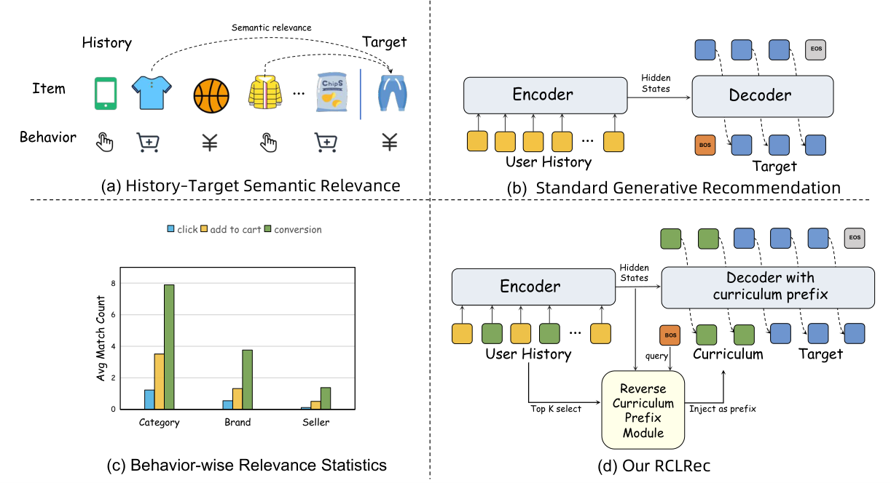

# RCLRec: Reverse curriculum learning for sparse conversions

<!-- source-sha256: 1b4a0b3f2bb3e3f80c84031f6e6e01a630f7b058ad52726d0149a6c513a65ab0 -->

[简体中文](README.md)

> Core public-data mechanism, not production conversion training.

## Paper information

| Field | Details |
|---|---|
| Paper | [Paper or original source](https://arxiv.org/abs/2603.28124) |
| Institution | Alibaba International Digital Commerce Group. |
| First public release | 2026-03-30 (arXiv v1) |
| Author code | No public author code found as of 2026-09-05. |
| Local adapter or method key | `rclrec` |
| Local reproduction code | [`src/auto_research/reproductions/rclrec/`](https://github.com/daiwk/auto-research/tree/main/src/auto_research/reproductions/rclrec/) |

## Paper method and evidence

Select short conversion-related subsequences as reverse-chronological decoder prefixes. Joint generation supplies intermediate supervision; quality-aware loss suppresses uninformative curriculum samples.


<!-- paper-figure:start -->
### Original paper figure

[](https://arxiv.org/html/2603.28124v1/intro_v2.png)

Figure shows reverse curriculum generation. From the [original paper](https://arxiv.org/abs/2603.28124); copyright remains with the authors.
<!-- paper-figure:end -->

### Core equation

$$
\mathcal L=\mathcal L_{target}+\lambda q(C)\mathcal L_{curriculum},\qquad C=\operatorname{ReverseSelect}(H).
$$

### Reported results

Online deployment reports ad revenue +2.09% and orders +1.86%.

## Local reproduction

```bash
auto-research reproduce --paper rclrec --dataset-dir data --seeds 42,43,44
```

MovieLens-1M fixed full catalog: NDCG@10 **0.05401→0.04768 (-11.71%)**. [Three-seed metrics, mean, SD and 95% CI](metrics/public-seeds42-44.json). Proxy targets do not transfer to production. No private features, production traffic or serving. These local public-data results do not reproduce online lift.
