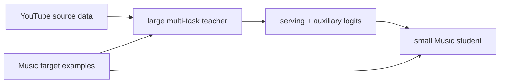
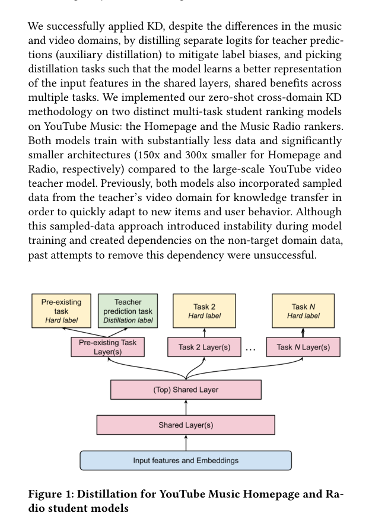

# Zero-shot cross-domain knowledge distillation: YouTube to YouTube Music

<!-- source-sha256: fd46ff46322e31135596fe8157b57ff74e170562bbfd7120a20ca07aafc8b350 -->

[简体中文](README.md)

> **Fidelity: core mechanism.** Runs a large source teacher, small target student, zero-shot target-example logits, and non-serving auxiliary-task distillation. The private cross-product schema is not reproduced.

## Paper information

| Field | Details |
|---|---|
| Paper | [arXiv 2603.28994](https://arxiv.org/abs/2603.28994) |
| Organization | Google / YouTube |
| First public release | 2026-03-30 (arXiv v1) |
| Authors' code | The paper did not provide official or author code when checked on 2026-08-09. |
| Adapter / method | `cross-domain-kd` |
| Local reproduction code | [`src/auto_research/reproductions/cross_domain_kd/`](https://github.com/daiwk/auto-research/tree/main/src/auto_research/reproductions/cross_domain_kd/) |

## Original paper

### Motivation and method

Low-traffic products cannot train a large specialized teacher. Apply a data-rich YouTube multitask teacher directly to YouTube Music examples, and distill both serving and auxiliary logits into a small model without requiring source-domain data or matching interface features.

<!-- paper-figure:start -->
### Key figure from the paper

> **Figure 1:** Overview of the paper's method and key components. From the [original paper](https://arxiv.org/abs/2603.28994); copyright remains with the authors.
<!-- paper-figure:end -->

### Core equation

$L=L_{target}+\lambda T^2KL(softmax(z_T/T)\Vert softmax(z_S/T))+\gamma\|a_T-a_S\|^2$.

### Paper results

CTR AUC 79.34→79.55 and trail engagement 0.312→0.320; online discovery **+1.12%** and new-releases engagement **+11.39%**.

## Local reproduction

> **Local comparison:** DIN trained on the same target split is the cross-model baseline. The KD student's NDCG@10 is **-68.46%** versus DIN. Distillation improves the target-only student by **+3.02%**; that is an increment over a weaker student, not a win over DIN.

180 source users and 60 target users, with 19,091 teacher parameters and 7,171 student parameters. On exactly the same target split, DIN Hit/NDCG is 0.1056/0.05518 and KD student is 0.0444/0.01741, or **-68.46%** relative NDCG. KD remains **+3.02%** above the target-only student, substantially behind DIN, while DIN has higher head share. See the [metrics](metrics/movielens-100k-seeds42-44.json).
