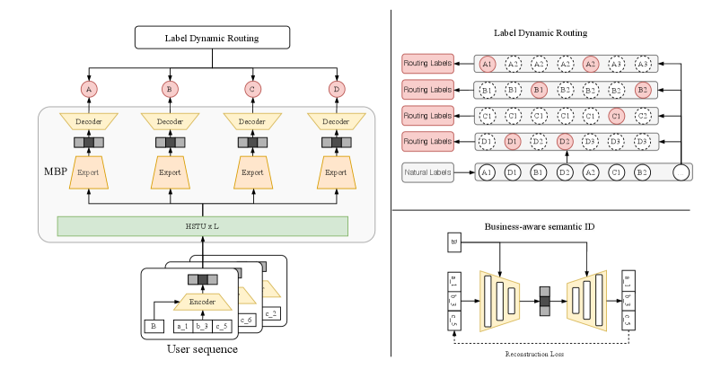

# MBGR: Multi-Business Generative Recommendation

<!-- source-sha256: 87c7f9840185cbf6865cdcf6def8690ad89e44ed4088d867ba6385f2475acdc4 -->

[简体中文](README.md)

> Core business-aware SID, shared experts, per-business prediction, and label dynamic routing.

## Paper information

| Field | Value |
| --- | --- |
| Paper | [arXiv 2604.02684](https://arxiv.org/abs/2604.02684) |
| Affiliations | Meituan |
| First public release | 2026-04-03 (arXiv v1) |
| Authors' code | No official author code linked as of 2026-08-09. |
| Adapter / method | `mbgr` |
| Local code | [`src/auto_research/reproductions/mbgr/`](https://github.com/daiwk/auto-research/tree/main/src/auto_research/reproductions/mbgr/) |

## Original paper

### Background and contribution

Ordinary next-item labels cover only the next logged business. A business-conditioned autoencoder retains SID semantics, shared MoE provides business representations, and LDR finds each business's nearest future interaction, masking missing labels.


<!-- paper-figure:start -->
### Key figure from the paper

[](https://arxiv.org/html/2604.02684v1/x1.png)

Original Figure 1: MBGR. From the [paper](https://arxiv.org/abs/2604.02684); copyright belongs to the authors. Not a local result.
<!-- paper-figure:end -->

### Core mechanism

$$
e^b=\sum_{k=1}^K g_k^b\operatorname{FFN}^{exp}_k([e,b]),\qquad i_{u,t+1}^{(k)}=i_{u,t'},\ t'=\min\{t''>t:b_{u,t''}=b_k\}.
$$

### Paper results

Meituan live A/B reports CTCVR +3.98%.

## Local reproduction

Versus shared next-item baseline, use 19 genre proxies and BID/MBP/LDR. Hit@10 **−4.17%**, NDCG@10 **−5.92%**. Validation chose blend 0.1. LDR masked 140,235 missing business targets. See [metrics](metrics/movielens-100k-seed42.json).

```bash
auto-research reproduce --paper mbgr --seed 42
```

## Reproduction limits

Genres do not replace private multibusiness logs or production generator scale.
