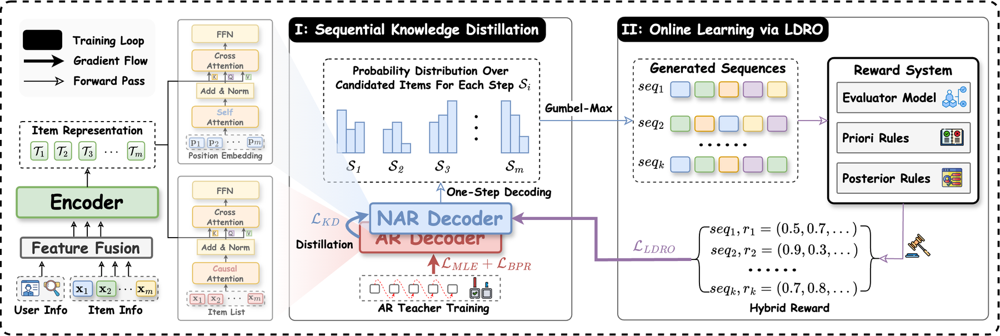

# Dual-Rerank: Fusing Sequential Dependencies and Utility for Generative Reranking

<!-- source-sha256: d3fbca24a9c4b3d462486378c1c4da5c6cf0563007a8f97b1b85a6d0598d0d5a -->

[简体中文](README.md)

> Core public-data reranking mechanism.

## Paper information

| Field | Details |
|---|---|
| Paper | [Paper or original source](https://arxiv.org/abs/2604.07420) |
| Institution | Kuaishou Technology. |
| First public release | 2026-04-08 (arXiv v1) |
| Author code | No official author code linked by the paper as checked on 2026-08-09. |
| Local adapter or method key | `dual-rerank` |
| Local reproduction code | [`src/auto_research/reproductions/dual_rerank/`](https://github.com/daiwk/auto-research/tree/main/src/auto_research/reproductions/dual_rerank/) |

## Paper method and evidence

An autoregressive teacher learns item-order dependencies; a non-autoregressive student predicts ranks in parallel. Utility distillation optimizes quality and latency.


<!-- paper-figure:start -->
### Original paper figure

[](https://arxiv.org/html/2604.07420v1/figures/Dual-Rerank-Overview.png)

Figure shows teacher and student reranking. From the [original paper](https://arxiv.org/abs/2604.07420); copyright remains with the authors.
<!-- paper-figure:end -->

### Core equation

$$
\mathcal L=\mathcal L_{rank}+\lambda\,D_{KL}(p_{AR}\Vert p_{NAR})+\gamma\mathcal L_{utility}.
$$

### Reported results

Kuaishou search on 5% traffic for a month: Long View +1.107% with lower mean and P99 latency.

## Local reproduction

MovieLens-100K, 260 users/420 items, full catalog, seed 42: shared transition+content baseline versus adding Dual-Rerank, NDCG@10 **0.0354→0.0392 (+10.66%)**. [Fixed metrics](metrics/public-seed42.json). No private logs, traffic, checkpoints or production serving; local results do not reproduce paper lift.

```bash
auto-research reproduce --paper dual-rerank --dataset-dir data --seed 42
auto-research evolve --model rankmixer --dataset movielens-100k --direction "Combine dual-rerank with installed paper operators" --generations 2 --population 4
```
