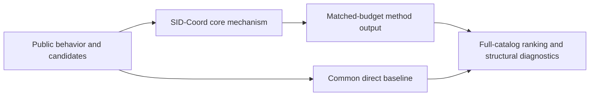
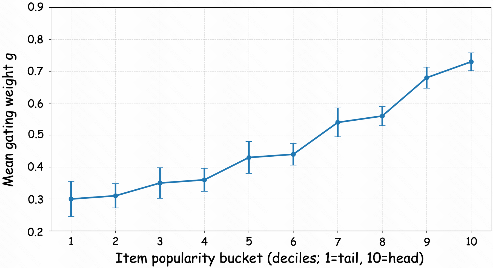

# SID-Coord: coordinated ranking with semantic IDs

<!-- source-sha256: acdb6f5b1db67ff6d674bd9f9fe1c7766bd9f423ffccba858a9d40ae8226c8bd -->

[简体中文](README.md)

> **Fidelity: core mechanism.** Runs the defining mechanism verifiable on public data. Private data, production models, and serving remain outside scope.

## Paper information

| Field | Details |
|---|---|
| Paper | [arXiv 2604.10471](https://arxiv.org/abs/2604.10471) |
| Organization | Kuaishou Technology |
| First public release | 2026-04-12 (arXiv v1) |
| Authors' code | No public author code was found on 2026-09-05. |
| Adapter / method | `sid-coord` |
| Local reproduction code | [`src/auto_research/reproductions/sid_coord/`](https://github.com/daiwk/auto-research/tree/main/src/auto_research/reproductions/sid_coord/) |

## Original paper

### Motivation and method

Rather than treating semantics as another dense feature, build multilevel discrete SIDs. Hierarchical fusion, target-aware HID–SID gating, and historical-interest alignment coordinate head-item memorization and long-tail generalization per example.



<!-- paper-figure:start -->
### Key figure from the paper

[](https://arxiv.org/html/2604.10471v1/fig3.png)

> **Figure 3:** Overview of the paper's method and key components. From the [original paper](https://arxiv.org/abs/2604.10471); copyright remains with the authors.
<!-- paper-figure:end -->

### Core equations

$$
s_i=(1-g_i)s_{HID,i}+g_i\sum_l\alpha_l s_{SID_i^l}+\lambda\,\operatorname{Align}(u,i).
$$

### Paper results

Short-video search online A/B reports long-play rate +0.664% and play time +0.369%. This is paper evidence, not a local public-data outcome.

## Local reproduction

> **Local comparison:** Under the same full-catalog protocol, baseline NDCG@10 is 0.05401 and SID-Coord NDCG@10 is 0.04970, **-7.97%** relative. The local proxy does not extrapolate to online lift.

See the [three-seed artifact](metrics/public-seeds42-44.json) for complete results, means, standard deviations, and 95% confidence intervals.

```bash
auto-research reproduce --paper sid-coord --dataset-dir data --seeds 42,43,44
```

## Reproduction boundaries

The local run uses a public MovieLens-1M subset and auditable proxies to validate the core computation. It does not reproduce private logs, production models, online traffic assignment, or serving. No claim is made to reproduce absolute paper metrics or online gains.
