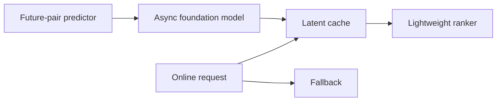
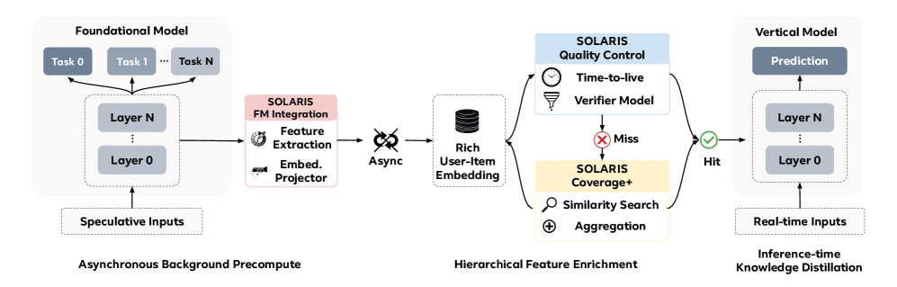

# SOLARIS: a predictive latent cache for serving a recommendation foundation model

<!-- source-sha256: f41b4a786874021a0b15f8e77949d8c3425410e9ac4e5d66fab55db24537ddda -->

[简体中文](README.md)

> **Fidelity: core mechanism.** Executes the future-pair predictor, asynchronous cache, and fallback.

## Paper information

| Field | Details |
|---|---|
| Paper | [arXiv 2604.12110](https://arxiv.org/abs/2604.12110) |
| Organization | Meta |
| First public release | 2026-04-13 (arXiv v1) |
| Authors' code | The paper did not supply official or author code when checked on 2026-08-09. |
| Adapter / method | `solaris` |
| Local reproduction code | [`src/auto_research/reproductions/solaris/`](https://github.com/daiwk/auto-research/tree/main/src/auto_research/reproductions/solaris/) |

## Original paper

### Motivation and method

A large recommender cannot compute latents for every user–item pair at request time. SOLARIS predicts which pairs will be accessed, asynchronously precomputes their latents with a foundation model, and caches them. Requests use cached latents on hits and fall back on misses.



<!-- paper-figure:start -->
### Key figure from the paper

[](https://arxiv.org/html/2604.12110v2/x1.png)

> **Figure 1:** Overview of the paper's method and key components. From the [original paper](https://arxiv.org/abs/2604.12110); copyright remains with the authors.
<!-- paper-figure:end -->

### Core equations

$$
\mathcal C_t=\{(u,i):p_\phi(i\mid u,t+\Delta)>\tau\},\qquad
s(u,i)=f(e_u,e_i,z_{u,i}^{\rm cache}).
$$

### Paper results

The paper reports full-traffic deployment and top-line revenue +0.67%.

## Local reproduction

The pair predictor learns from the next three interactions. Only high-confidence pairs are cached; the run measures cache coverage and fallback behavior.

> **Local comparison:** Request-time ranking is the baseline; the predictive latent cache is the treatment. NDCG@10 rises from 0.03540 to 0.09118, or +157.58% relative; see `metrics/movielens-100k-seed42.json`.

```bash
auto-research reproduce --paper solaris --dataset-dir data --seed 42
```
