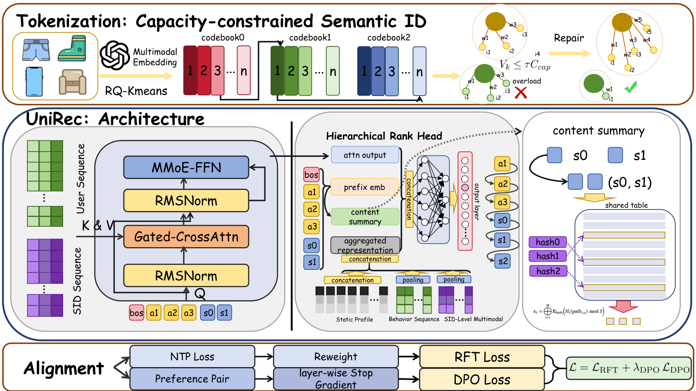

# UniRec: Bridging the Expressive Gap between Generative and Discriminative Recommendation via Chain-of-Attribute

<!-- source-sha256: d1478a0e805e7e5a437bf8c24a4d7a365710fed834d23a9ee8fa6f2d89cdc83b -->

[简体中文](README.md)

> **Fidelity: core mechanism.** Paper online outcomes, local public-data results, and omissions are separate.

## Paper information

| Field | Details |
|---|---|
| Paper | [arXiv 2604.12234](https://arxiv.org/abs/2604.12234) |
| Organization | The authors do not disclose an affiliation; the setting is a large e-commerce platform |
| First public release | 2026-04-14 (arXiv v1) |
| Authors' code | The paper did not provide official or author code when checked on 2026-08-24. |
| Adapter / method | `unirec-coa` |
| Local reproduction code | [`src/auto_research/reproductions/unirec_coa/`](https://github.com/daiwk/auto-research/tree/main/src/auto_research/reproductions/unirec_coa/) |

## Original paper

### Motivation and method

Generate category, seller, and brand attribute chains before SIDs. Capacity-constrained quantization suppresses hot-token collapse, and task context stabilizes generation across scenarios.


<!-- paper-figure:start -->
### Key figure from the paper

[](https://arxiv.org/html/2604.12234v4/Unirec.png)

> **Figure 1:** Core architecture, modules, and connections. From the [original paper](https://arxiv.org/abs/2604.12234); copyright remains with the authors.
<!-- paper-figure:end -->

### Core equations

$$
p(a,s|u)=p(a|u)\prod_l p(s_l|a,s_{<l},u)
$$

### Paper results

Online GMV rises **+5.60%** with 20% user traffic per bucket (Section 4.2, Table 5). The private paper protocol is not directly comparable with local MovieLens measurements.

## Local reproduction

> **Local comparison:** The baseline is the shared transition + content scorer. The treatment adds only unirec-coa on the same users, items, full-catalog candidates, and seed.

MovieLens-100K, 220 users and 360 items, seed 42: NDCG@10 0.0540 → **0.0513 (-4.93%)**; Hit@10 0.1091 → 0.0818. Validation selects mixture weights only; the test set is not used for tuning.

```bash
auto-research reproduce --paper unirec-coa --dataset-dir data --seed 42
```

See the [fixed metrics](metrics/public-seed42.json).

## Reproduction boundaries

The core mechanism runs on MovieLens-100K with the same split, fixed full-catalog candidates, and seed. Private features, the production foundation model, and online traffic are unavailable. The implementation has independent model state and scoring and retains negative results. Local changes and paper A/B gains are reported separately.
