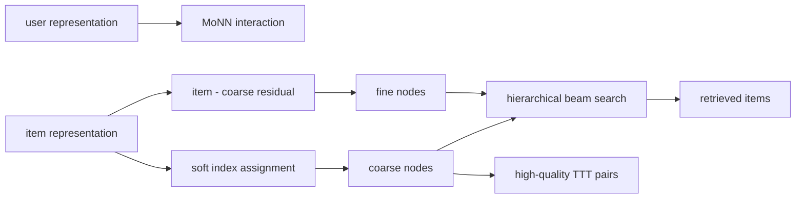
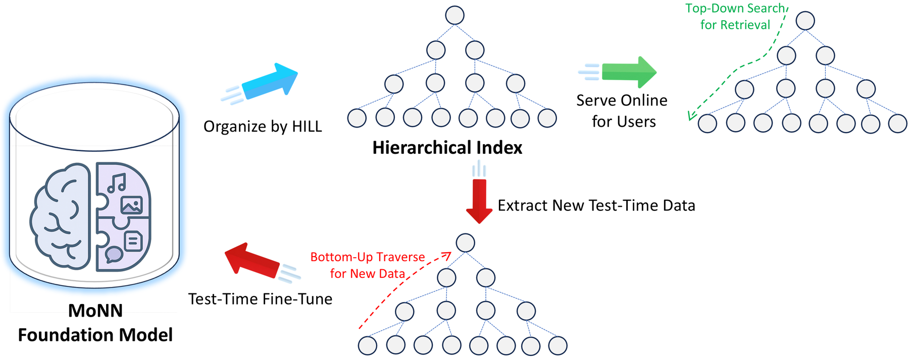

# HILL: Jointly Learning a Hierarchical Index for Retrieval Foundation Models

<!-- source-sha256: 5bd1536f8df578feb94c2da8ea95057fbef1c1423ab33a475464e92232dda39f -->

[简体中文](README.md)

> **Fidelity: core mechanism.** Executes soft assignment, cross-layer residual quantization, hierarchical beam retrieval, and a fixed public split. It is not an offline k-means tree relabeled as HILL.

## Paper information

| Field | Details |
|---|---|
| Paper | [EDBT 2026 / arXiv 2604.12965](https://arxiv.org/abs/2604.12965) |
| Organization | Meta / Facebook and Instagram Ads |
| First public release | 2026-04-14 (arXiv v1) |
| Authors' code | No official HILL/MoNN implementation released in the paper; it only links third-party Gowalla, Yelp 2018, and Amazon-Book data repositories (checked 2026-09-01). |
| Adapter / method | `hill-index` |
| Local reproduction code | [`src/auto_research/reproductions/hill_index/`](https://github.com/daiwk/auto-research/tree/main/src/auto_research/reproductions/hill_index/) |

## Original paper

### Motivation and method

A large retrieval foundation model cannot run complex user–item interaction towers over the whole catalog online. Rather than building independent ANN over item embeddings, HILL learns index nodes with MoNN user, item, and interaction signals. Attention-like soft assignment at the first layer leaves residuals for the next to quantize. Hierarchical retrieval narrows candidates at each level; upper nodes also produce a small set of high-quality test-time-training samples.



<!-- paper-figure:start -->
### Key figure from the paper

[](https://arxiv.org/html/2604.12965v1/figures/framework.png)

> **Figure 1:** Workflow, key stages, and data flow. From the [original paper](https://arxiv.org/abs/2604.12965); copyright remains with the authors.
<!-- paper-figure:end -->

### Core equation

Distance and soft assignment of item $v_j$ to node $c_k$:

$$
d(j,k)=\lVert v_j-c_k\rVert_2^2,\qquad a_k=\frac{e^{-\alpha d(j,k)}}{\sum_{k'}e^{-\alpha d(j,k')}}.
$$

The pseudo-item $\bar c=\sum_k a_kc_k$ enters MoNN with the user. The next level quantizes $r_j=v_j-\bar c_j$, retaining complementary information.

### Paper results

- Recall@20, NDCG@20, and compute are compared on Gowalla, Yelp 2018, Amazon-Book, and Meta internal data.
- Meta Ads production A/B: two-layer `MoNN Medium → MoNN Small` raises the online ads metric 2.57% versus MoNN Small; Small/Small raises it 1.22%.
- The service covers daily Facebook and Instagram ads recommendation; production models and logs were not released.

## Local reproduction

> **Local comparison.** Same features and queries, similar candidate budgets, single-level learned index versus a residual child level and hierarchical beam. Seed 42 retrieves about 23.30% of the catalog and produces -34.82% relative NDCG@10.

Trees vary substantially across seeds. The small public catalog does not reproduce the quality gain, but executes residual hierarchy and candidate reduction. See [per-seed metrics, mean, standard deviation, and 95% CI](metrics/public-seeds42-44.json).

```bash
auto-research reproduce --paper hill-index --dataset-dir data --seed 42
```

## Limits

The local work lacks MoNN's thousands of features, semisupervised multitask training, billion-item Meta Ads index, FAISS EM, and production QPS. Intermediate node counts are a public TTT-data proxy, not online test-time training.
