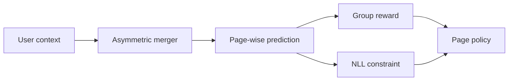
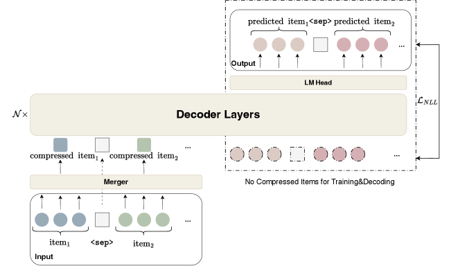

# GenRec: Page-Wise Generative Recommendation

<!-- source-sha256: 79c7e65cb2d5d4580e0151d9c2f7548385b8e1b305c6de7e171554b48abce380 -->

[简体中文](README.md)

> Page-wise NTP, asymmetric token merging, GRPO-SR, and NLL run.

## Paper information

| Field | Value |
| --- | --- |
| Paper | [arXiv 2604.14878](https://arxiv.org/abs/2604.14878) |
| Affiliations | JD.com |
| First public release | 2026-04-16 (arXiv v1) |
| Authors' code | No official author code linked as of 2026-08-09. |
| Adapter / method | `genrec` |
| Local code | [`src/auto_research/reproductions/genrec/`](https://github.com/daiwk/auto-research/tree/main/src/auto_research/reproductions/genrec/) |

## Original paper

### Background and contribution

Item-at-a-time generation ignores complements and ordering on a page. Predict the next page, compress its inputs with an asymmetric merger, optimize group reward, and retain NLL to limit drift.



<!-- paper-figure:start -->
### Key figure from the paper

[](https://arxiv.org/html/2604.14878v1/x1.png)

Original Figure 1: GenRec. From the [paper](https://arxiv.org/abs/2604.14878); copyright belongs to the authors. Not a local result.
<!-- paper-figure:end -->

### Core mechanism

$$
\mathcal L=\mathcal L_{\rm GRPO-SR}+\lambda\mathcal L_{\rm NLL},\qquad
A_i=R_i-\frac1G\sum_{j=1}^{G}R_j.
$$

### Paper results

JD.com's online results report +9.5% clicks and +8.7% transactions.

## Local reproduction

Group three consecutive positive interactions into a page. Optimize position-aware advantage with NLL. Pointwise ranking NDCG@10 is 0.03540 vs. 0.07621 (+115.30%) locally; see `metrics/movielens-100k-seed42.json`.

```bash
auto-research reproduce --paper genrec --dataset-dir data --seed 42
```

## Reproduction limits

Local page-proxy evidence is separate from production click and transaction measurements.
