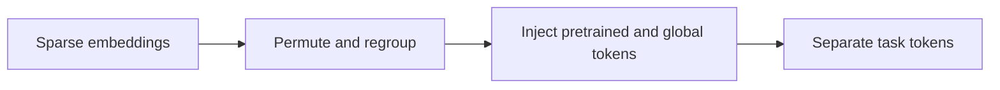
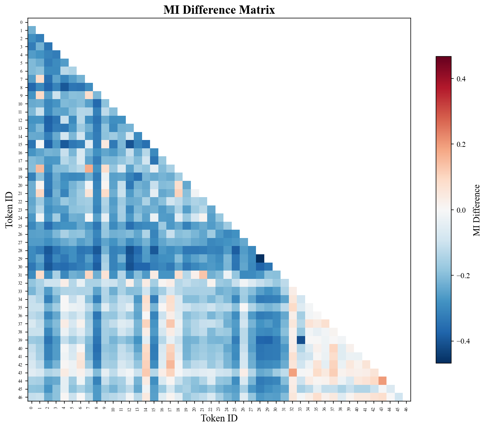

# RankUp: High-rank representations for advertising recommendation

<!-- source-sha256: 1a3c2f544a9e6449ec3fe0f8f51f87fbde75a12d3c6d2e1e80bf2516292f1f17 -->

[简体中文](README.md)

> Core public-data representation mechanism.

## Paper information

| Field | Details |
|---|---|
| Paper | [Paper or original source](https://arxiv.org/abs/2604.17878) |
| Institution | Tencent. |
| First public release | 2026-04-20 (arXiv v1) |
| Author code | No public author code found as of 2026-09-05. |
| Local adapter or method key | `rankup` |
| Local reproduction code | [`src/auto_research/reproductions/rankup/`](https://github.com/daiwk/auto-research/tree/main/src/auto_research/reproductions/rankup/) |

## Paper method and evidence

Counter representation collapse with randomized grouping, multiple embeddings, global tokens, cross-pretrained embedding injection and decoupled task tokens so added capacity increases representational rank.



<!-- paper-figure:start -->
### Original paper figure

[](https://arxiv.org/html/2604.17878v3/figs/mi_different_matrix_cluster_48.png)

Figure shows the high-rank feature pipeline. From the [original paper](https://arxiv.org/abs/2604.17878); copyright remains with the authors.
<!-- paper-figure:end -->

### Core equation

$$
H=\operatorname{Concat}_{m=1}^{M}\phi\!\left(E_m(XP_m)W_m\right),\qquad H'=H+g.
$$

### Reported results

Full deployment on WeChat Channels, Official Accounts and Moments reports GMV **+3.41%, +4.81%, +2.12%**, respectively.

## Local reproduction

```bash
auto-research reproduce --paper rankup --dataset-dir data --seeds 42,43,44
```

MovieLens-1M fixed catalog: NDCG@10 **0.05401→0.04702 (-12.94%)**. [Three-seed metrics, mean, SD and 95% CI](metrics/public-seeds42-44.json). No private features, production traffic or serving. These local public-data results do not reproduce online lift.
