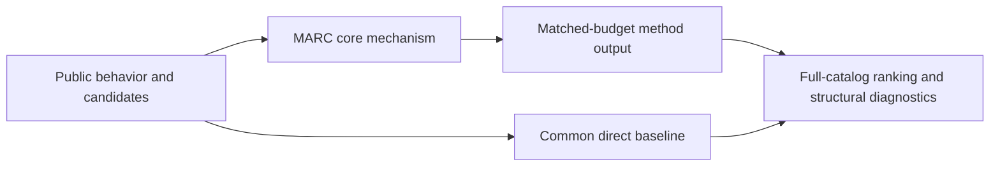
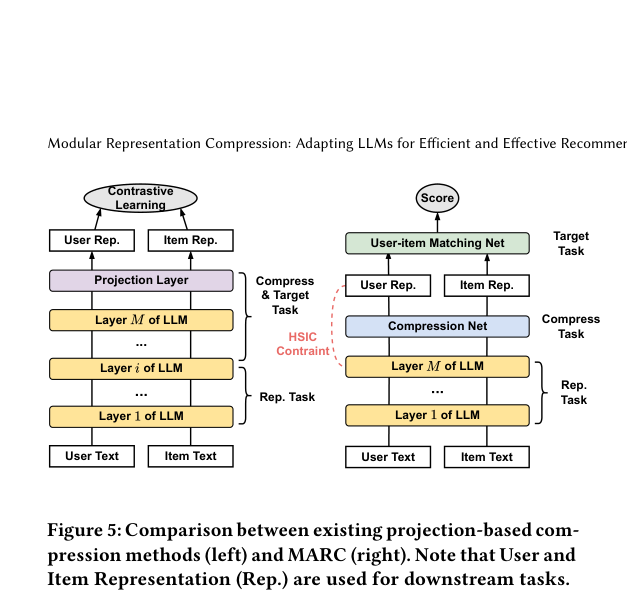

# MARC: modular representation compression

<!-- source-sha256: ca84e5876b12f0f23c43bf7c9939cbd38e3d00dad168b5ca6be78772e0b1f25a -->

[简体中文](README.md)

> **Fidelity: core mechanism.** Runs the defining mechanism verifiable on public data. Private data, production models, and serving remain outside scope.

## Paper information

| Field | Details |
|---|---|
| Paper | [arXiv 2604.18146](https://arxiv.org/abs/2604.18146) |
| Organization | Shanghai Jiao Tong University |
| First public release | 2026-04-20 (arXiv v1) |
| Authors' code | No public author code was found when checked on 2026-09-05. |
| Adapter / method | `marc` |
| Local reproduction code | [`src/auto_research/reproductions/marc/`](https://github.com/daiwk/auto-research/tree/main/src/auto_research/reproductions/marc/) |

## Original paper

### Motivation and method

After recommendation compression, intermediate LLM layers can outperform the final layer (MRA). MARC separates compression from task adaptation and uses information constraints to decouple the proxy task from recommendation. It retains task-relevant information while reducing dimension.



<!-- paper-figure:start -->
### Key figure from the paper

[](https://arxiv.org/pdf/2604.18146#page=5)

> **Figure 5:** Overview of the paper's method and key components. From the [original paper](https://arxiv.org/abs/2604.18146); copyright remains with the authors.
<!-- paper-figure:end -->

### Core equations

$$
z=P_k\big(h_{mid}-\Pi_{nuisance}h_{mid}\big),\qquad s(i)=\langle z_u,z_i\rangle.
$$

### Paper results

A commercial search-advertising online A/B test reports eCPM +2.82%. This is paper evidence, not a local public-data outcome.

## Local reproduction

> **Local comparison:** Under the same full-catalog MovieLens protocol, baseline NDCG@10 is 0.05401 and treatment NDCG@10 is 0.04693, **-13.11%** relative. The local proxy and production task differ, so there is no extrapolation to online lift.

See the [three-seed artifact](metrics/public-seeds42-44.json) for complete results, means, standard deviations, and 95% confidence intervals.

```bash
auto-research reproduce --paper marc --dataset-dir data --seeds 42,43,44
```

## Reproduction boundaries

The local run uses a public MovieLens-1M subset and auditable proxies to check the core computation only. It does not reproduce private logs, the production foundation model, online traffic assignment, or serving. There is no claim to reproduce absolute paper metrics or online gains.
