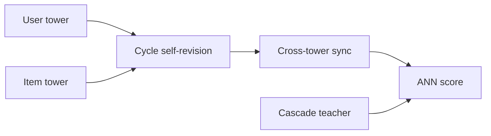
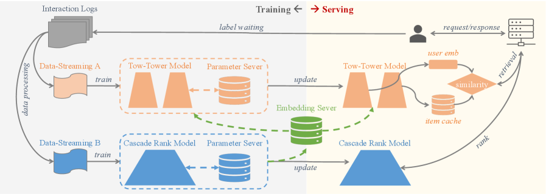

# CS3

<!-- source-sha256: 3dac867a82e63419c5c8259e26cbf551488d9263873508ebe7d0a33b4544e2f9 -->

[简体中文](README.md)

> **Core-mechanism reproduction.** Cycle revision, cross-tower synchronization, and cascade-teacher auxiliary loss.

## Paper information

| Field | Value |
| --- | --- |
| Paper | [arXiv 2604.19269](https://arxiv.org/abs/2604.19269) |
| Affiliations | Kuaishou Technology |
| First public release | 2026-04-21 (arXiv v1) |
| Authors' code | [Author code](https://github.com/lixiangwang/CS3Rec). |
| Adapter / method | `cs3` |
| Local code | [`src/auto_research/reproductions/cs3/`](https://github.com/daiwk/auto-research/tree/main/src/auto_research/reproductions/cs3/) |

## Original paper

### Background and contribution

Independent towers enable ANN but limit interactions. CS3 adds cycle revision and knowledge coordination while preserving offline and online deployability.



<!-- paper-figure:start -->
### Key figure from the paper

[](https://arxiv.org/html/2604.19269v1/x2.png)

Original Figure 2: CS3 architecture. From the [paper](https://arxiv.org/abs/2604.19269); copyright belongs to the authors. Not a local result.
<!-- paper-figure:end -->

### Core mechanism

$$
u'=u+g_u(u,i)\odot\Delta_u,\quad i'=i+g_i(i,u)\odot\Delta_i,\quad
L=L_{\rm rank}+\lambda L_{\rm cascade}.
$$

### Paper results

Revenue rose **8.356% / 1.366% / 2.177%** across three Kuaishou production settings.

## Local reproduction

Matched two towers are the baseline. Cycle, cross sync, and teacher loss gave **−16.06%** relative three-seed NDCG@10, not the online gain. See [metrics](metrics/movielens-100k-seeds42-44.json).

```bash
auto-research reproduce --paper cs3
```

## Reproduction limits

No 400-million-DAU cache, EMA cross-tower vectors, or production QPS path.
