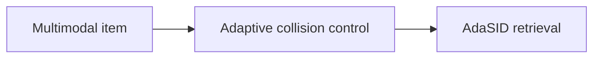
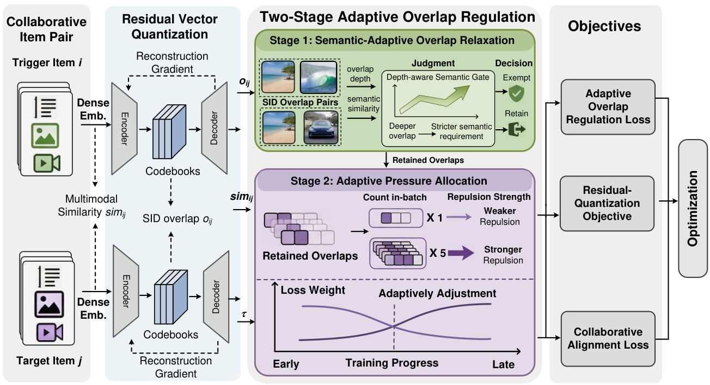

# Beyond Static Collision Handling: Adaptive Semantic ID Learning for Multimodal Recommendation at Industrial Scale

<!-- source-sha256: d147d26af5b5918b8b8cdc314404667c1c9cb130bdfa9f9e8a1aa20f9e3a989f -->

[简体中文](README.md)

> **Fidelity: core mechanism.** Paper online outcomes, local public-data results, and omissions are separate.

## Paper information

| Field | Details |
|---|---|
| Paper | [arXiv 2604.23522](https://arxiv.org/abs/2604.23522) |
| Organization | University of Electronic Science and Technology of China / Kuaishou |
| First public release | 2026-04-26 (arXiv v1) |
| Authors' code | The paper did not provide official or author code when checked on 2026-08-24. |
| Adapter / method | `adasid` |
| Local reproduction code | [`src/auto_research/reproductions/adasid/`](https://github.com/daiwk/auto-research/tree/main/src/auto_research/reproductions/adasid/) |

## Original paper

### Motivation and method

Relax semantic-ID overlap constraints dynamically using collision load, semantic compatibility, and training stage instead of penalizing every collision equally.



<!-- paper-figure:start -->
### Key figure from the paper

[](https://arxiv.org/html/2604.23522v1/figure2_v4.png)

> **Figure 2:** Core architecture, modules, and connections. From the [original paper](https://arxiv.org/abs/2604.23522); copyright remains with the authors.
<!-- paper-figure:end -->

### Core equations

$$
\lambda_{ij}(t)=g(o_{ij},\operatorname{sim}_{ij},t),\quad L=L_{rq}+\sum_{ij}\lambda_{ij}L_{overlap}
$$

### Paper results

Online **GPM +1.16%** over four days with tens of millions of users (Section 5.3, Table 3). The private paper protocol is not directly comparable with local MovieLens measurements.

## Local reproduction

> **Local comparison:** The baseline is the shared transition + content scorer. The treatment adds only adasid on the same users, items, full-catalog candidates, and seed.

MovieLens-100K, 220 users and 360 items, seed 42: NDCG@10 0.0540 → **0.0506 (-6.30%)**; Hit@10 0.1091 → 0.0909. Validation selects mixture weights only; the test set is not used for tuning.

```bash
auto-research reproduce --paper adasid --dataset-dir data --seed 42
```

See the [fixed metrics](metrics/public-seed42.json).

## Reproduction boundaries

The core mechanism runs on MovieLens-100K with the same split, fixed full-catalog candidates, and seed. Private features, the production foundation model, and online traffic are unavailable. The implementation has independent model state and scoring and retains negative results. Local changes and paper A/B gains are reported separately.
