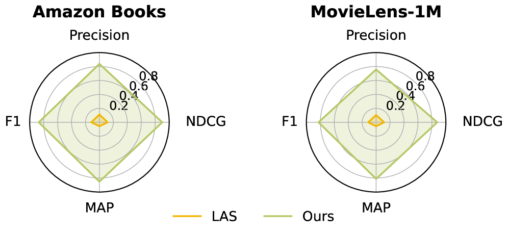

# From Local Indices to Global Identifiers: Generative Reranking via Global Action Space

<!-- source-sha256: 6a7f72904546cbccaabe7789958ebcaa4b3d364cc47a80739dd36a61ee25634a -->

[简体中文](README.md)

> Core public-data generation mechanism.

## Paper information

| Field | Details |
|---|---|
| Paper | [Paper or original source](https://arxiv.org/abs/2604.25291) |
| Institution | City University of Hong Kong / Kuaishou / UC San Diego. |
| First public release | 2026-04-28 (arXiv v1) |
| Author code | No official author code linked by the paper as checked on 2026-08-09. |
| Local adapter or method key | `glorank` |
| Local reproduction code | [`src/auto_research/reproductions/glorank/`](https://github.com/daiwk/auto-research/tree/main/src/auto_research/reproductions/glorank/) |

## Paper method and evidence

A global SID action space turns local reranking into full-catalog generation. Listwise SFT precedes group-relative optimization of slate utility and tail coverage.


<!-- paper-figure:start -->
### Original paper figure

[](https://arxiv.org/html/2604.25291v1/x5.png)

Figure shows global-action reranking. From the [original paper](https://arxiv.org/abs/2604.25291); copyright remains with the authors.
<!-- paper-figure:end -->

### Core equation

$$
J(\theta)=\mathbb E_{\pi_\theta(Y|h)}[R_{list}(Y)],\quad R=R_{rel}+\lambda R_{global}.
$$

### Reported results

Kuaishou 7.8% traffic, 14 days: watch time +0.095%, effective views +0.111%, likes +0.286%.

## Local reproduction

MovieLens-100K, 260 users/420 items, full catalog, seed 42: shared transition+content versus GloRank, NDCG@10 **0.0354→0.0197 (-44.26%)**. [Fixed metrics](metrics/public-seed42.json). No private logs, traffic, checkpoints or production serving; local results do not reproduce paper lift.

```bash
auto-research reproduce --paper glorank --dataset-dir data --seed 42
auto-research evolve --model rankmixer --dataset movielens-100k --direction "Combine glorank with installed paper operators" --generations 2 --population 4
```
