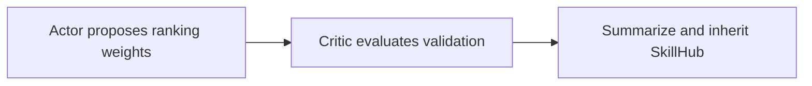
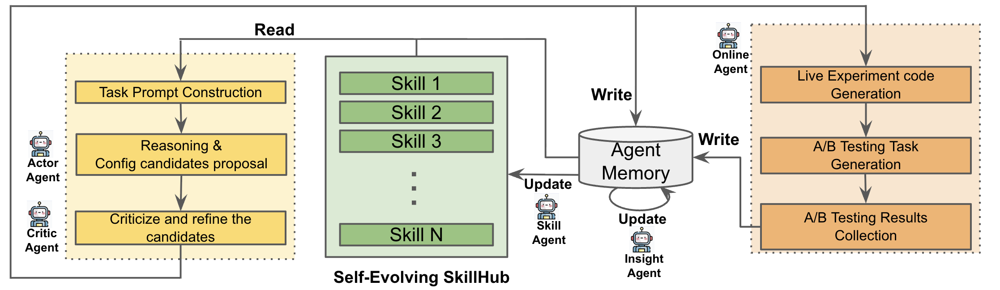

# AgenticRecTune: Optimize recommendation with multiple agents and a self-evolving SkillHub

<!-- source-sha256: 577f19e686b62b5cff25150df3488cbb65835a454142de3a037fe66277fa7eae -->

[简体中文](README.md)

> Three real local rounds of proposals, evaluation and SkillHub inheritance.

## Paper information

| Field | Details |
|---|---|
| Paper | [Paper or original source](https://arxiv.org/abs/2604.26969) |
| Institution | Google / Discover. |
| First public release | 2026-04-21 (arXiv v1) |
| Author code | No official author code linked by the paper as checked on 2026-08-09. |
| Local adapter or method key | `agentic-rec-tune` |
| Local reproduction code | [`src/auto_research/reproductions/agentic_rec_tune/`](https://github.com/daiwk/auto-research/tree/main/src/auto_research/reproductions/agentic_rec_tune/) |

## Paper method and evidence

Actor proposes, Critic checks risk, Insight summarizes findings, Skill persists knowledge, and Online returns experiment-platform feedback across retrieval, fusion and reranking.



<!-- paper-figure:start -->
### Original paper figure

[](https://arxiv.org/html/2604.26969v2#S1.F1)

The original figure shows the multi-agent optimization loop. From the [original paper](https://arxiv.org/abs/2604.26969); copyright remains with the authors.
<!-- paper-figure:end -->

### Core equation

$$
g_{t+1}=\arg\max_{g\in\operatorname{Actor}(g_t,\mathcal S_t)}\operatorname{Critic}(g;D_{val}),\qquad \mathcal S_{t+1}=\mathcal S_t\cup\{g_{t+1}\}.
$$

### Reported results

Live A/B, p<0.05. Value-based retrieval/pre-ranking Engagement1/Engagement2/Diversity **+0.75%/+0.90%/+0.48%**; fusion/ranking **+0.62%/+0.19%/+0.06%**; diversity/reranking **+0.21%/+0.29%/+3.43%**.

## Local reproduction

Three rounds with up to nine ranking genomes each, validation-only Critic and isolated final test. Champion transition/content/diversity **0.30/0.35/0.35**. Versus fixed manual recipe, Hit@10 **+8.33%**, NDCG@10 **+17.34%**, fresh Hit@10 **+150%**. [Metrics](metrics/movielens-100k-seed42.json). Local executable weights, not Google's scheduling API or online agent.

```bash
auto-research reproduce --paper agentic-rec-tune --dataset-dir data --seed 42
```
